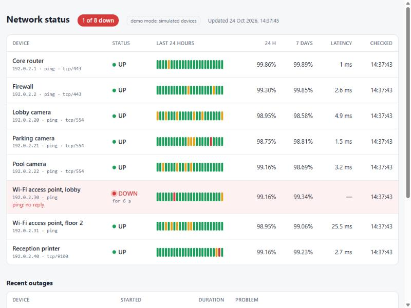

# Daniil Dushin — Portfolio

[](https://github.com/dushinitspec-ux/portfolio-daniil/actions/workflows/ci.yml)

AI Developer & IT/Network Technician based in Antalya, open to relocation.
I build AI tools that save businesses time — and I set up the hardware they run on.

**Website:** [site-production-898c.up.railway.app](https://site-production-898c.up.railway.app) · **Email:** dushin.itspec@gmail.com · [LinkedIn link]

This repository holds everything an employer needs in one place: CVs, the portfolio website,
ten production-style projects and promo videos for the first three.

## Projects

| # | Project | Problem it solves | Stack | Tests |
|---|---------|-------------------|-------|-------|
| 01 | [Fridge Alert Bot](projects/01-fridge-alert-bot) | Spoiled food and failed hygiene inspections | FastAPI, aiogram 3, SQLite, matplotlib | 69 |
| 02 | [Hotel AI Concierge](projects/02-hotel-ai-concierge) | Reception answers the same questions all day, in four languages | aiogram 3, Claude / OpenAI API, SQLite | 57 |
| 03 | [Uptime Monitor](projects/03-uptime-monitor) | Cameras, routers or Wi-Fi go down and nobody notices | asyncio, FastAPI, HTMX, aiogram 3, SQLite | 45 |
| 04 | [PII Guard](projects/04-pii-guard) | Staff paste customers' personal data into AI chats (GDPR) | FastAPI, HTMX, Claude API, phonenumbers, SQLite | 152 |
| 05 | [E-Invoice](projects/05-e-invoice) | PDF invoices while the EU moves to structured e-invoices (EN 16931, XRechnung) | FastAPI, pdfplumber, lxml, Claude API, SQLite | 180 |
| 06 | [Helpdesk Copilot](projects/06-helpdesk-copilot) | IT support answers the same questions; answers must come from the company's own how-tos | aiogram 3, BM25, Claude API, FastAPI, SQLite | 95 |
| 07 | [Network Inventory](projects/07-network-inventory) | Nobody knows what is on the office network (NIS2 asset management) | asyncio, FastAPI, aiogram 3, SQLite | 107 |
| 08 | [Accessibility Check](projects/08-accessibility-check) | Online shops fall under the European Accessibility Act since June 2025 | httpx, BeautifulSoup, FastAPI, Claude API, SQLite | 200 |
| 09 | [Energy Saver](projects/09-energy-saver) | Boilers and EV chargers run in the most expensive hours of the day-ahead market | asyncio, FastAPI, aiogram 3, SQLite | 100 |
| 10 | [Allergen Labels](projects/10-allergen-labels) | Menus must declare the 14 EU allergens, in the guests' languages | FastAPI, Jinja2, Claude API, SQLite | 207 |

Every project:

- runs in **demo mode** with simulated or bundled sample data — no hardware and no paid API keys needed;
- has tests (`pytest`) and passes linting (`ruff`), checked by GitHub Actions on every push;
- ships with `.env.example`, `Dockerfile` and `docker-compose.yml`;
- keeps a `BUGFIX.md` with the real bugs found while building it (root cause, fix, before/after code).



## Repository structure

```
portfolio-daniil/
├── docs/        CVs for four kinds of roles (+ Russian copies) and the project list
├── site/        Portfolio website: Next.js 14, TypeScript, Tailwind, MDX, EN/RU/TR/DE
├── remotion/    Cover images for every project and promo videos for 01–03 (Remotion, React)
└── projects/
    ├── 01-fridge-alert-bot/
    ├── 02-hotel-ai-concierge/
    ├── 03-uptime-monitor/
    ├── 04-pii-guard/
    ├── 05-e-invoice/
    ├── 06-helpdesk-copilot/
    ├── 07-network-inventory/
    ├── 08-accessibility-check/
    ├── 09-energy-saver/
    └── 10-allergen-labels/
```

## Quick start

Python projects use [uv](https://docs.astral.sh/uv/) and Python 3.12:

```bash
cd projects/01-fridge-alert-bot
cp .env.example .env
uv sync
uv run pytest
```

The website needs Node.js 22:

```bash
cd site
npm install
npm run dev
```

See the README inside each folder for details.

## How I work

I build with AI coding agents and check everything myself: each project runs end to end,
has automated tests, and documents the real bugs I hit — including the ones that only
appeared on a real network or a non-English Windows.

## Contact

dushin.itspec@gmail.com · [Telegram](https://t.me/daniil_dushin) · [LinkedIn link] · [GitHub](https://github.com/dushinitspec-ux)
