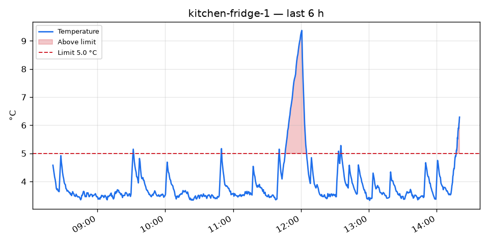
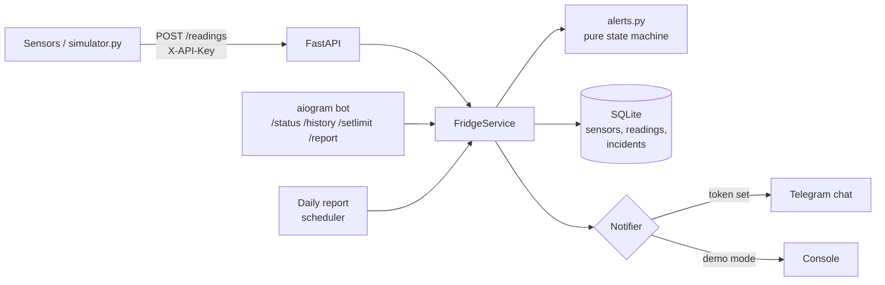
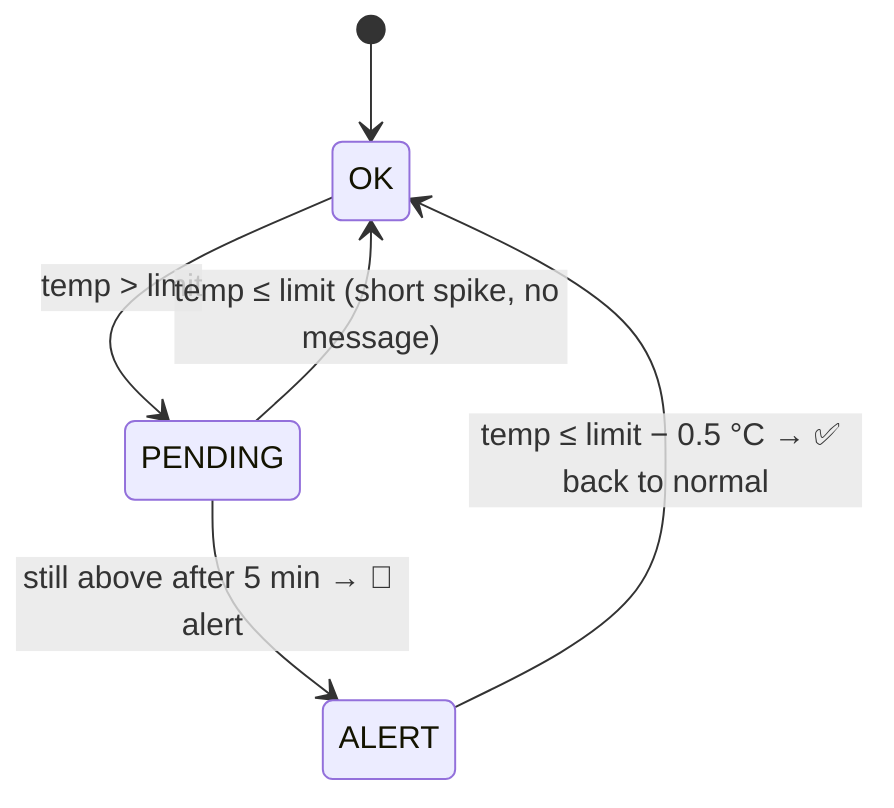

# Fridge Alert Bot

[](https://github.com/dushinitspec-ux/fridge-alert-bot/actions/workflows/ci.yml)

**[▶ Live demo in your browser](https://site-production-898c.up.railway.app/en/projects/fridge-alert-bot/demo)** · [Case study](https://site-production-898c.up.railway.app/en/projects/fridge-alert-bot) · Part of [Daniil Dushin's portfolio](https://github.com/dushinitspec-ux/portfolio-daniil)

Telegram alerts when a restaurant or hotel fridge stays too warm.

## Problem

A fridge that quietly warms up overnight means spoiled food in the morning, and a gap in the
temperature log means trouble at a hygiene inspection. Staff check thermometers by hand a few
times a day, which misses most failures. Cheap temperature probes exist; what is missing is
something that watches them and calls a person at the right moment, without crying wolf every
time someone opens the door.

## Features

- **HTTP API** for sensors: `POST /readings` with `{sensor_id, temperature, timestamp}`.
- **Alert rule:** a Telegram message when a fridge stays above its limit for 5 minutes
  (configurable), and a "back to normal" message with the incident duration and peak.
- **No alert spam:** one alert per incident; short spikes (door opened) never alert;
  0.5 °C hysteresis stops alert/recovery flapping when the temperature hovers at the limit.
- **Bot commands:**
  - `/status` — every fridge with its last temperature, state and data age;
  - `/history <sensor> [hours]` — PNG chart (matplotlib) with the limit and breaches;
  - `/setlimit <sensor> <°C>` — change a limit;
  - `/report` — summary of the last 24 h (min / avg / max, time above limit, incidents);
  - `/id` — shows the chat id, needed for setup.
- **Daily report** sent automatically at 09:00 local time (configurable).
- **Robust input:** API key for writes, rejects broken-probe values (85 °C, −127 °C),
  readings from the future, duplicates; late readings go to history without corrupting state.
- **Demo mode:** `simulator.py` generates realistic data with door openings and compressor
  failures; without a bot token, alerts are printed to the console.

## Screenshots



| Alert in Telegram | /status | /report |
|---|---|---|
| [screenshot placeholder] | [screenshot placeholder] | [screenshot placeholder] |

## Architecture



The alert rule is a pure function with no I/O, so every edge case is covered by fast unit tests:



API, bot and scheduler run in one process and share one `FridgeService`, so they can never
disagree about a sensor's state. An `asyncio.Lock` around the read-evaluate-write cycle stops two
simultaneous requests from sending the same alert twice (there is a test for it).

## Quick start (demo, no Telegram needed)

Requires [uv](https://docs.astral.sh/uv/) (it installs Python 3.12 itself).

```bash
cp .env.example .env
uv sync
uv run python -m app                                            # terminal 1: API on :8000
uv run python simulator.py --api-key change-me --backfill-hours 24 --fail kitchen-fridge-1   # terminal 2
```

Then open <http://127.0.0.1:8000/sensors/kitchen-fridge-1/chart.png> and
<http://127.0.0.1:8000/docs>. After about 5–10 minutes the forced failure crosses the limit and
the alert is printed in terminal 1. Set `ALERT_DELAY_MINUTES=1` in `.env` to see it sooner.

With Docker: `cp .env.example .env && docker compose --profile demo up --build`.

### Connect Telegram

1. Create a bot with [@BotFather](https://t.me/BotFather) and put the token in `BOT_TOKEN`.
2. Add the bot to the kitchen group, send `/id`, put the number in `ALERT_CHAT_ID`.
3. Restart. Only that chat (plus `ALLOWED_CHAT_IDS`) can use the commands.

## API

| Method | Path | Auth | Description |
|---|---|---|---|
| POST | `/readings` | key | One reading |
| POST | `/readings/batch` | key | Up to 10 000 readings (late uploads, backfill) |
| PUT | `/sensors/{id}/limit` | key | `{"limit": 5.0}` |
| GET | `/sensors` | — | All sensors with state |
| GET | `/sensors/{id}/history?hours=24` | — | Readings as JSON |
| GET | `/sensors/{id}/chart.png?hours=24` | — | The same chart the bot sends |
| GET | `/report?hours=24` | — | Summary as JSON |
| GET | `/health` | — | Liveness check |

Interactive docs: `/docs`. Example:

```bash
curl -X POST localhost:8000/readings -H "X-API-Key: change-me" -H "Content-Type: application/json" \
  -d '{"sensor_id": "bar-fridge", "temperature": 4.2, "timestamp": "2026-10-24T09:00:00Z"}'
```

## Configuration

All settings live in `.env` (see [.env.example](.env.example) for comments). The important ones:

| Variable | Default | Meaning |
|---|---|---|
| `BOT_TOKEN` | empty | Empty = demo mode, alerts go to the console |
| `ALERT_CHAT_ID` | empty | Chat that receives alerts |
| `API_KEY` | `change-me` | Sensors send it in `X-API-Key` |
| `DEFAULT_LIMIT_C` | `5.0` | Limit for new sensors (5 °C is a common limit for chilled food) |
| `ALERT_DELAY_MINUTES` | `5` | How long above the limit before alerting |
| `RECOVERY_HYSTERESIS_C` | `0.5` | How far below the limit counts as "back to normal" |
| `DAILY_REPORT_TIME` | `09:00` | Local time of the automatic report; empty disables it |

## Design decisions and assumptions

The task left these open; this is what I chose and why.

- **Time comes from the reading, not the server clock.** The 5-minute rule compares sensor
  timestamps, so buffered uploads after a network outage are evaluated correctly.
- **Old events do not notify.** If a sensor uploads an incident from 3 hours ago, it is saved in
  history and in the report, but nobody is woken up (`ALERT_MAX_AGE_MINUTES`).
- **Sensors register themselves** on the first reading with the default limit. `/setlimit` (or
  `PUT /sensors/{id}/limit`) works for unknown sensors too, so limits can be set up in advance.
- **Writes need the API key; reads do not.** The service is meant for a private network. Put it
  behind a reverse proxy with auth before exposing it to the internet.
- **`/report` covers the last 24 hours,** not "since midnight", because the automatic report is
  sent in the morning.
- **SQLite** is enough for dozens of sensors at one reading per 15–60 s. Readings are unique per
  `(sensor_id, timestamp)`, so retries are safe.

## Project structure

```
app/
  alerts.py      alert rule (pure state machine)
  service.py     business logic used by the API, bot and scheduler
  api.py         FastAPI endpoints
  bot.py         aiogram commands
  db.py          SQLite repository
  report.py      daily summary maths
  charts.py      matplotlib PNG charts
  messages.py    Telegram message texts
  scheduler.py   daily report timing
  simulation.py  thermal model of a fridge
  main.py        runs API + bot + scheduler in one event loop
simulator.py     CLI that sends simulated readings
tests/           pytest suite
```

## Tests and linting

```bash
uv run pytest
uv run ruff check . && uv run ruff format --check .
```

The tests cover the alert state machine, the service (duplicates, late readings, concurrent
requests, a broken Telegram connection), the API, report maths, timezone and daylight-saving
handling, and the simulator itself: a single door opening must not alert, a compressor failure
must.

## Bugs found while building

See [BUGFIX.md](BUGFIX.md).

## Next steps

- Alert when a sensor goes silent (now it only shows as ⚪ in `/status`).
- Export the temperature log as a PDF for hygiene inspectors.
- Support real probes: an ESP32 + DS18B20 sketch that posts to `/readings`.
