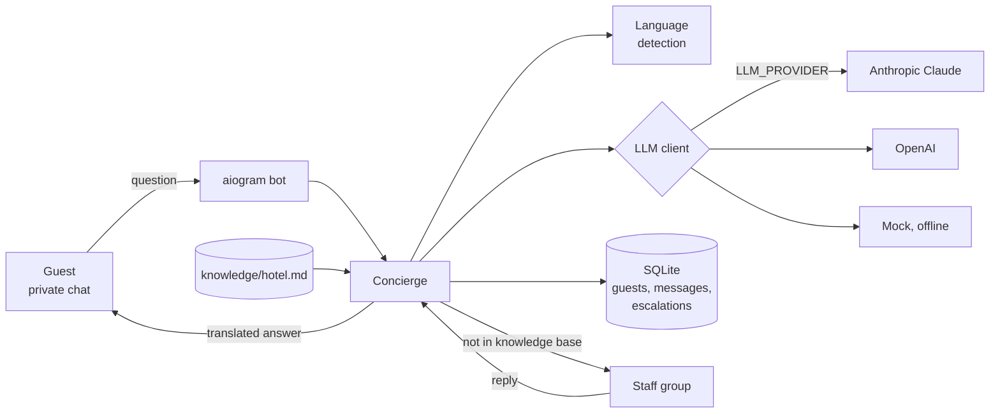
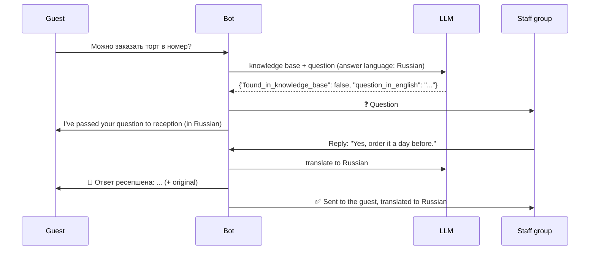

# Hotel AI Concierge

A Telegram bot that answers hotel guests in English, Russian, Turkish and German, using only
the hotel's own knowledge base. If the answer isn't there, it doesn't guess. It passes the
question to the reception team and delivers their reply back to the guest.

## Problem

The reception desk answers the same questions all day: breakfast hours, the Wi-Fi password,
when the pool opens, how to book a transfer. In a resort hotel in Turkey, guests ask them in
several languages, and staff often don't speak all of them. Every repeated question is time
not spent on guests standing at the desk.

A plain chatbot is risky here: an LLM that invents a check-out time or a price causes real
trouble at the desk. This bot answers only from facts the hotel wrote down and hands
everything else to a person.

## Features

- **Answers from a knowledge base** (`knowledge/hotel.md`, plain Markdown) with an LLM:
  Anthropic Claude or OpenAI, chosen in `.env`.
- **Replies in the guest's language** (EN / RU / TR / DE), detected from the message, with the
  conversation language and the Telegram app language as fallbacks for short messages.
- **Does not invent.** The model returns structured JSON with a `found_in_knowledge_base`
  flag; anything not covered goes to a **staff Telegram group** with an English translation.
- **Staff reply in the group, the guest gets the answer.** Staff simply use Telegram's
  "Reply" on the bot's message; the bot translates the reply into the guest's language and
  shows the original below.
- **Safe failure:** if the LLM is down, rate-limited or declines, the question goes to staff;
  if the staff group is unreachable, the guest is told to ask at the desk, never left waiting.
- **Admin commands:** `/reload` re-reads the knowledge base without a restart (a broken file
  keeps the old version), `/stats` shows how many questions the bot answered itself.
- **Conversation log** in SQLite: guests, every message, every escalation and its status.
- **Per-guest rate limit**, because every message is a paid LLM call.
- **Offline demo mode** with a mock LLM: no API key, no Telegram, one command.

## Screenshots

| Guest asks in Russian | Question in the staff group | Staff reply delivered |
|---|---|---|
| [screenshot placeholder] | [screenshot placeholder] | [screenshot placeholder] |

## Architecture



The path of a question the bot cannot answer:



`Concierge` holds all the logic and knows nothing about Telegram, so the same code runs in the
bot, in the terminal demo and in the tests.

## Quick start (offline demo, no keys needed)

Requires [uv](https://docs.astral.sh/uv/) (it installs Python 3.12 itself).

```bash
cp .env.example .env
uv sync
uv run python -m app.demo        # scripted conversation in four languages
uv run python -m app.demo -i     # type as a guest; "/staff <text>" answers as reception
```

The mock LLM only matches keywords and cannot translate, so its answers quote the English
knowledge base. Set `LLM_PROVIDER=anthropic` (or `openai`) and an API key to see real answers
in the guest's language; the demo uses the same settings.

## Run the Telegram bot

1. Create a bot with [@BotFather](https://t.me/BotFather), put the token in `BOT_TOKEN`.
2. Create a staff group, add the bot, send `/id` in the group, put the number in
   `STAFF_CHAT_ID`. Privacy mode can stay on: bots still receive replies to their own messages.
3. Send `/id` to the bot in a private chat and put your user id in `ADMIN_IDS`.
4. Choose the LLM: `LLM_PROVIDER=anthropic` + `ANTHROPIC_API_KEY`, or `openai` + `OPENAI_API_KEY`.
5. `uv run python -m app`, or `docker compose up -d --build`.

To change what the bot knows, edit `knowledge/hotel.md` and send `/reload`. Each `## ` heading
is one topic. With Docker the folder is mounted, so no rebuild is needed.

## Design decisions

- **The whole knowledge base goes into the prompt, no vector search.** A hotel FAQ is a few
  thousand tokens. Retrieval would add a database, an embedding model and a new way to fail
  (the right paragraph not retrieved) for no gain. The knowledge base is a stable system
  prompt, so it is **prompt-cached** by Anthropic and repeat requests are much cheaper.
  Past ~50 pages it would be time for retrieval.
- **Structured output instead of "say UNKNOWN if you don't know".** Both providers are asked
  for JSON matching a schema (`found_in_knowledge_base`, `answer`, `question_in_english`), so
  the decision to escalate is a boolean, not string matching on the model's prose.
- **Any doubt goes to a human.** API errors, refusals, cut-off replies, an empty answer with
  `found=true`: all of them escalate. The worst case is a slower answer, never a wrong one.
- **Language detection is rule-based,** not an LLM call: it works offline, costs nothing and is
  fully tested. The four languages are easy to tell apart by alphabet, special letters
  (ı ş ğ / ä ß) and common words. The LLM still writes the answer, so a rare misdetection only
  changes the language of fixed phrases.
- **Guest text is marked as data** (`<guest_message>`), and the system prompt says to treat it
  as a question, not instructions: basic protection against "ignore your rules" messages.
- **Anthropic: refusal fallback is on** (`fallbacks="default"`): if the model declines for a
  policy reason, the API retries on its recommended fallback model.
- **Models are configurable.** Defaults: `claude-opus-5-5` (effort `medium`) and
  `gpt-5-mini`; change `ANTHROPIC_MODEL` / `OPENAI_MODEL` to trade quality for cost.

## Configuration

See [.env.example](.env.example); every variable has a comment. The main ones:

| Variable | Default | Meaning |
|---|---|---|
| `LLM_PROVIDER` | `mock` | `mock` (offline), `anthropic` or `openai` |
| `BOT_TOKEN` | empty | Telegram bot token |
| `STAFF_CHAT_ID` | empty | Group that receives unanswered questions |
| `ADMIN_IDS` | empty | Users allowed to `/reload` and `/stats` |
| `TRANSLATE_STAFF_REPLIES` | `true` | Translate staff answers into the guest's language |
| `RATE_LIMIT_PER_MINUTE` | `10` | Messages per guest per minute |

## Project structure

```
app/
  concierge.py   core logic: answer or escalate, route staff replies
  bot.py         aiogram handlers: guests, staff group, admin commands
  language.py    EN/RU/TR/DE detection
  knowledge.py   loads and reloads knowledge/hotel.md
  llm/           provider-neutral interface + Anthropic, OpenAI and mock clients
  db.py          SQLite: guests, conversation log, escalations
  texts.py       fixed phrases in four languages
  ratelimit.py   per-guest sliding-window limit
  demo.py        terminal demo
  main.py        starts the bot
knowledge/hotel.md   the knowledge base (fictional demo hotel)
tests/               pytest suite
```

## Tests and linting

```bash
uv run pytest
uv run ruff check . && uv run ruff format --check .
```

The tests cover language detection, the answer/escalate logic, staff reply routing and
translation, failure paths (LLM down, translation down, staff chat unreachable), the
knowledge base reload, and an end-to-end run through aiogram's dispatcher with a fake
Telegram session. The Anthropic and OpenAI clients are tested against a fake HTTP server, so
the tests check the exact request we send (schema, caching, fallback) without an API key.

## Bugs found while building

See [BUGFIX.md](BUGFIX.md).

## Next steps

- Voice messages: transcribe, then answer the same way.
- A small web page for staff to edit the knowledge base instead of a file.
- Notify staff when a question waits longer than N minutes.
