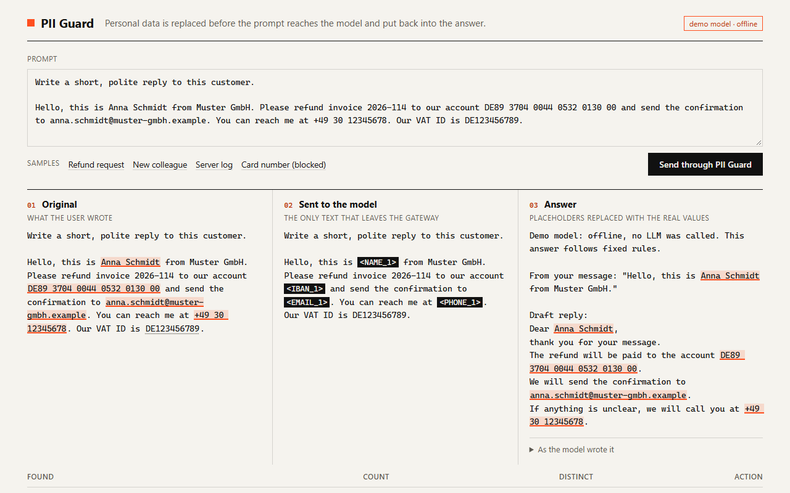
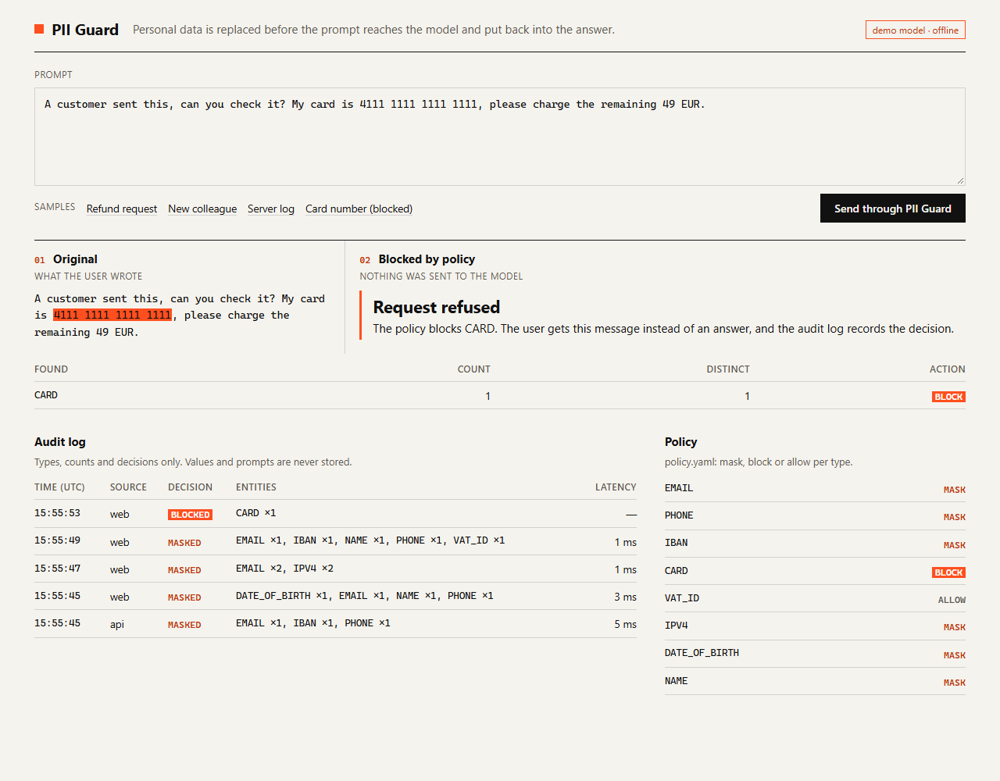
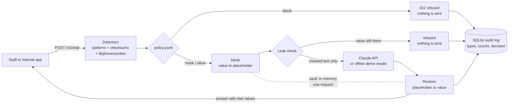

# PII Guard

[](https://github.com/dushinitspec-ux/pii-guard/actions/workflows/ci.yml)

**[▶ Live demo in your browser](https://site-production-898c.up.railway.app/en/projects/pii-guard/demo)** · [Case study](https://site-production-898c.up.railway.app/en/projects/pii-guard) · Part of [Daniil Dushin's portfolio](https://github.com/dushinitspec-ux/portfolio-daniil)

A small gateway between a company's staff (or internal apps) and an LLM. It finds personal
data in a prompt, replaces it with placeholders such as `<EMAIL_1>` and `<IBAN_1>`, sends only
the masked text to the model, and puts the real values back into the answer before the user
reads it. A policy file decides per type of data: mask it, block the request, or allow it.

## Problem

Staff want to paste customer e-mails, tickets and log lines into an LLM: "write a polite
reply", "what happened in this log". Those texts are full of personal data: names, e-mail
addresses, phone numbers, IBANs. A company in the EU has to keep personal data to what is
necessary for the purpose (GDPR Art. 5(1)(c), "data minimisation"), and the model usually
does not need the real IBAN to draft a reply about a refund. It needs to know that there *is*
an IBAN and where it goes.

PII Guard does the boring part automatically: the model gets `refund to <IBAN_1>`, the user
gets the reply with the real IBAN in it, and the audit log shows what kind of data was
removed and how often, never the data itself.

## Features

- **Detectors with real validation, not just patterns:**

  | Type | Found by | Validated by |
  |---|---|---|
  | `IBAN` | country code + check digits, print or electronic form | length per country from the SWIFT IBAN registry, check digits 02-98, ISO 13616 mod-97 |
  | `CARD` | groups of digits | issuer prefix and length per brand, Luhn, realistic grouping (4-4-4-4, 4-6-5) |
  | `EMAIL` | pattern | RFC 5321 length limits, dot rules |
  | `VAT_ID` | uppercase EU prefix (`DE`, `ATU`, `EL`, `XI` ...) | the per-country structure from the European Commission's VIES FAQ |
  | `IPV4` | dotted quad | four octets 0-255, no leading zeros |
  | `PHONE` | groups of digits with `+`, `()`, `-`, `/` | Google's libphonenumber metadata (`phonenumbers`): E.164 and national formats of the regions you configure |
  | `DATE_OF_BIRTH` | a date within 40 characters after "born", "geb.", "doğum", "родился", "date of birth" ... | a real calendar date between 1900 and today |
  | `NAME` | a names list you provide (CRM export, HR list) | whole words only |

- **Stable placeholders per request:** the same value gets the same placeholder everywhere in
  the conversation (`DE89370400440532013000` and `DE89 3704 0044 0532 0130 00` are one
  `<IBAN_1>`); numbering is per type; placeholders that already appear in the text are skipped.
- **Restore** puts the values back however often the model repeats a placeholder, tolerates
  `<email_1>` or `< EMAIL_1 >`, and leaves a placeholder the model invented (`<EMAIL_7>`)
  untouched instead of guessing.
- **Fail closed:** after masking, every value that should be masked is searched for in the
  outgoing text. If one is still there, the request is refused and nothing is sent.
- **Policy file** [`policy.yaml`](policy.yaml): `mask`, `block` or `allow` per type. Blocked
  requests never reach the model.
- **Audit log in SQLite:** time, source, decision, entity types and counts, model, latency.
  There is no column that could hold a value or a prompt.
- **API:** `POST /v1/chat` (messages in, restored answer out, plus what was masked),
  `POST /v1/mask` (dry run), `GET /v1/audit`.
- **Web page** (FastAPI + Jinja2 + HTMX, works without JavaScript too): the original, the
  text the model received and the restored answer side by side.
- **Claude** via the official Anthropic SDK, or an **offline demo model** that needs no key.
- **CLI:** `uv run python -m app mask "text"` prints the text as the model would receive it.

## Screenshots





Both are real screenshots of the demo (`uv run python -m app --demo`), taken with headless
Edge at 1280 px width.

## How it works



The vault (placeholder to value) exists only in memory for the duration of one request. It
is not logged, stored or returned by the API.

Detection runs in priority order (IBAN, card, e-mail, VAT ID, IPv4, date of birth, phone,
name). What one detector claims is blanked out before the next one runs, so the digits of an
IBAN are never also read as a phone number, and a phone number right after an IBAN is still
found.

## Quick start (demo, no API key)

Requires [uv](https://docs.astral.sh/uv/) (it installs Python 3.12 itself).

```bash
cp .env.example .env
uv sync
uv run python -m app --demo
```

Open <http://127.0.0.1:8104> and pick a sample, or paste your own text. In demo mode the
answers come from a small deterministic fake model: it quotes your message and drafts a reply
with every placeholder it received. Nothing leaves your machine.

With Docker: `cp .env.example .env && docker compose up --build` (the Dockerfile and compose
file mirror the other projects in this repository; Docker was not available on the machine
this was built on, so they have not been run).

### Use Claude

In `.env` set `DEMO_MODE=false` and `ANTHROPIC_API_KEY=...`, then `uv run python -m app`.
Model and effort are configurable (`ANTHROPIC_MODEL=claude-opus-5-5`,
`ANTHROPIC_EFFORT=medium`). Only masked text is sent.

## API

```bash
curl -s http://127.0.0.1:8104/v1/chat -H "Content-Type: application/json" -d '{
  "messages": [{"role": "user", "content": "Write a short reply. Refund to DE89 3704 0044 0532 0130 00 and confirm to anna.schmidt@muster-gmbh.example, phone +49 30 12345678."}]
}'
```

```json
{
  "decision": "masked",
  "answer": "... The refund will be paid to the account DE89 3704 0044 0532 0130 00. ...",
  "entities": [
    {"type": "EMAIL", "action": "mask", "count": 1, "distinct": 1},
    {"type": "PHONE", "action": "mask", "count": 1, "distinct": 1},
    {"type": "IBAN", "action": "mask", "count": 1, "distinct": 1}
  ],
  "sent_to_llm": [{"role": "user", "content": "Write a short reply. Refund to <IBAN_1> and confirm to <EMAIL_1>, phone <PHONE_1>."}],
  "llm_answer": "... The refund will be paid to the account <IBAN_1>. ...",
  "unknown_placeholders": [],
  "model": "demo (offline)",
  "latency_ms": 1
}
```

| Endpoint | What it does |
|---|---|
| `POST /v1/chat` | Conversation in (`user` / `assistant` messages, first and last from the user), restored answer out. `422` with `"error": "blocked_by_policy"` if the policy blocks a type, `413` if too long, `502` if the model fails. |
| `POST /v1/mask` | `{"text": "..."}`: the masked text and the findings. Dry run: no model call, no audit entry. |
| `GET /v1/audit?limit=50` | Latest audit entries, newest first. |
| `GET /healthz` | Liveness check. |

FastAPI's interactive docs are at `/docs`.

## CLI

```bash
uv run python -m app mask "Refund to DE89 3704 0044 0532 0130 00, geb. 14.03.1985"
# IBAN: 1 found, mask                        (stderr)
# DATE_OF_BIRTH: 1 found, mask               (stderr)
# Refund to <IBAN_1>, geb. <DATE_OF_BIRTH_1> (stdout)
```

`-` reads the text from stdin. The exit code is `2` when the policy blocks the text.
`--demo` also loads the demo names list.

## Configuration

See [.env.example](.env.example).

| Variable | Default | Meaning |
|---|---|---|
| `DEMO_MODE` | `true` in the example | Offline demo model instead of Claude |
| `ANTHROPIC_API_KEY` | empty | Claude API key (the SDK's other credential sources also work) |
| `ANTHROPIC_MODEL` | `claude-opus-5-5` | Model id |
| `ANTHROPIC_EFFORT` | `medium` | `low` / `medium` / `high` / `xhigh` / `max` |
| `ANTHROPIC_MAX_TOKENS` | `16000` | Longest answer |
| `POLICY_FILE` | `policy.yaml` | mask / block / allow per type |
| `NAMES_FILE` | empty | Known names, one per line; `names.demo.txt` in demo mode |
| `PHONE_REGIONS` | `DE` | Regions whose national formats are recognised, e.g. `DE,AT,TR` |
| `DATABASE_PATH` | `data/audit.db` | Audit log |
| `MAX_INPUT_CHARS` | `20000` | Longest accepted request |
| `HOST` / `PORT` | `127.0.0.1` / `8104` | Where the gateway listens |

## What this means for GDPR (and what it does not)

This is a technical tool, not legal advice, and using it does not make anyone "GDPR
compliant". What it does, in the regulation's own terms:

- Names, e-mail addresses, phone numbers and IBANs are personal data when they relate to an
  identifiable person (GDPR [Art. 4(1)](https://eur-lex.europa.eu/eli/reg/2016/679/oj), which
  names "an online identifier" as one way to identify someone; Recital 30 lists IP addresses
  as such identifiers).
- Replacing them with placeholders while the gateway keeps the mapping is close to what the
  GDPR calls **pseudonymisation** (Art. 4(5)): the data cannot be attributed to a person
  without additional information that is kept separately. Here that information lives only in
  the gateway's memory, for one request.
- Pseudonymised data is **still personal data** for anyone who could re-identify it
  (Recital 26), and the EDPB's
  [Guidelines 01/2025 on pseudonymisation](https://www.edpb.europa.eu/our-work-tools/documents/public-consultations/2025/guidelines-012025-pseudonymisation_en)
  (version for public consultation) say the same holds even when the pseudonymised data and the
  additional information are with different parties. The rest of a prompt can also identify a
  person ("the only Turkish-speaking customer in our Graz branch"). Treat masked prompts as
  personal data that has been reduced, not as anonymous data.
- It supports **data minimisation** (Art. 5(1)(c): "adequate, relevant and limited to what is
  necessary") and is the kind of measure Art. 25(1) (data protection by design) names,
  "such as pseudonymisation".
- The LLM provider remains a **processor** you need a contract with (Art. 28), and if it
  processes data outside the EU/EEA, the rules for **transfers** in Chapter V (Art. 44 ff.)
  still apply. PII Guard reduces what is sent; it does not replace either.

Sources: Regulation (EU) 2016/679, [EUR-Lex](https://eur-lex.europa.eu/eli/reg/2016/679/oj);
EDPB Guidelines 01/2025 (adopted for consultation on 16 January 2025); VAT ID formats from the
[European Commission's VIES FAQ](https://ec.europa.eu/taxation_customs/vies/).

## Tests and linting

```bash
uv run pytest
uv run ruff check . && uv run ruff format --check .
```

152 test cases (87 test functions, some parametrized). They cover:

- validators: valid and invalid IBANs (including `DE89 3704 0044 0532 0130 00`, a changed
  digit, wrong length, and check digits 99 that pass mod-97 but are not issued), Luhn, card
  brands, VAT formats per country, IPv4, e-mail, dates;
- detectors: the refund sample, phone formats per region, IBANs next to other words and numbers,
  dates of birth in five languages, things that must *not* be detected (invoice numbers,
  meeting dates, version numbers, lowercase VAT prefixes);
- a **round-trip property test** on 500 random texts: no masked value, and no 4+ character
  piece of one, ever reaches the masked text, and `restore(mask(x)) == x`;
- policy (block, allow, default, error messages), the fail-closed leak check, placeholders
  shared across a conversation;
- the gateway: the model only ever receives placeholders; blocked requests never call it;
  the audit database file and the log output contain no value;
- the Claude client against a fake HTTP server (request body, fallback beta header, refusal,
  cut-off answer, server error), the demo model, the API, the web page, and the CLI (including
  its piped output on Windows, see BUGFIX.md, bug 1).

## Measured

On the development machine (Windows 11, Python 3.12), timing `Guard.prepare()` (detect, apply the policy,
mask, leak check):

| Input | Median |
|---|---|
| The refund sample, 293 characters | 0.4 ms (200 runs) |
| Samples repeated, 16,710 characters | 22 ms (10 runs) |
| Worst case: 20,000 characters of digit groups only | 0.86 s (3 runs) |

In demo mode a whole `/v1/chat` round trip took 1-6 ms in my runs. With Claude, the model's answer time
dominates.

## Limitations

- **Names:** without an NER model (deliberately: no torch or spaCy), only names from the list
  you provide are found. A name that is not on the list goes to the model.
- **Addresses, ID card numbers, health data and free-text descriptions of a person are not
  detected.** The rest of a prompt can still identify someone.
- Phone numbers in national format are only recognised for the regions in `PHONE_REGIONS`.
  International numbers (`+...`, `00...`) are found for any country.
- A stray number right after a phone number can become part of it: `+49 30 12345678 12` is
  itself a valid Berlin number, so the `12` is masked together with it.
- VAT IDs are checked against the format, not the national check digits; dates of birth only
  in numeric formats (`14.03.1985`, `1985-03-14`, `03/14/1985`).
- No authentication: run it inside the company network or behind a reverse proxy that does it.
- The masked text is only as good as the detectors. The tests and the leak check reduce the
  risk of a miss; they cannot prove there is none.

## Project structure

```
app/
  entities.py    entity types and their priority
  validators.py  IBAN mod-97, Luhn, card brands, VAT formats, IPv4, e-mail, dates
  detectors.py   finding candidates in text, splitting digit runs, resolving overlaps
  masking.py     placeholders, the per-request vault, restore
  policy.py      policy.yaml: mask / block / allow
  guard.py       detect, apply the policy, mask, leak check (no web, no LLM)
  gateway.py     one request end to end: guard, LLM, restore, audit
  audit.py       SQLite audit log
  llm/           Claude client, offline demo model, the system prompt
  web.py         FastAPI routes; templates/ has the page
  samples.py     sample texts for the page (all values are examples)
  cli.py         python -m app [--demo] | mask "text"
policy.yaml        what to do with each type
names.demo.txt     names the demo knows
tests/             pytest suite
docs/              screenshots
```

## Bugs found while building

See [BUGFIX.md](BUGFIX.md).

## Next steps

- IPv6 addresses, postal addresses and national ID numbers.
- Optional NER for names (e.g. a small ONNX model) behind the same detector interface.
- Streaming answers, restoring placeholders that are split across chunks.
- Per-team policies and API keys for the gateway itself.
