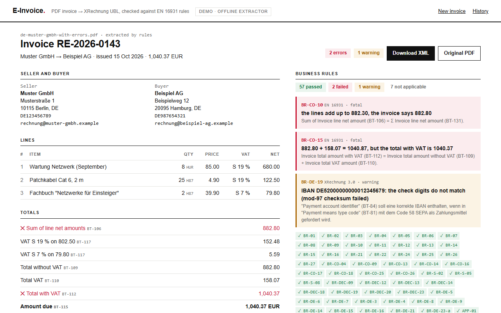
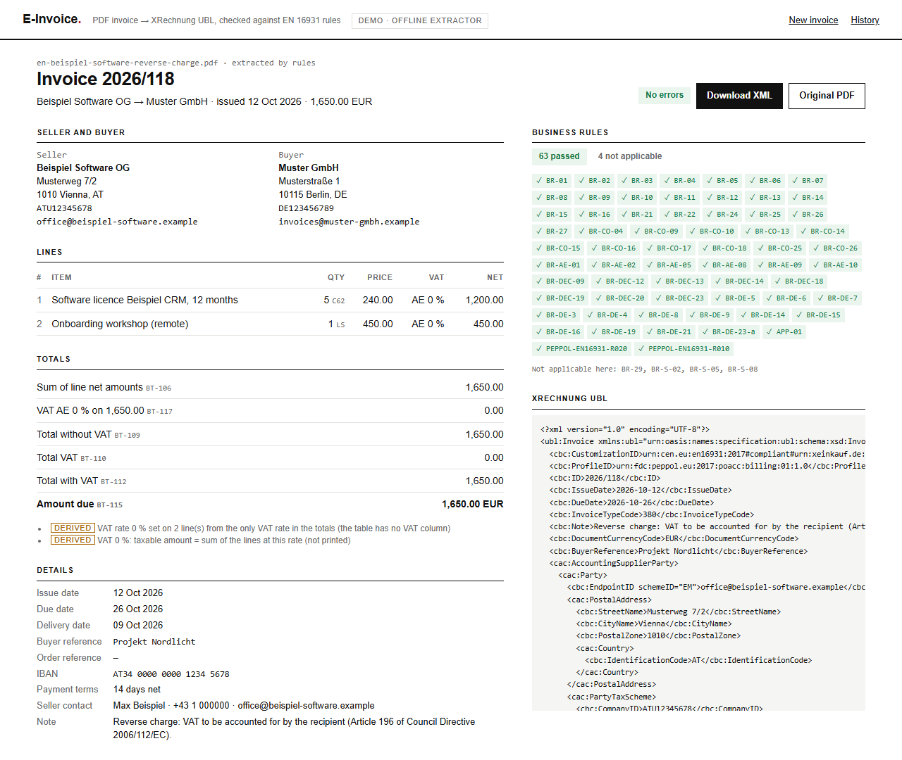
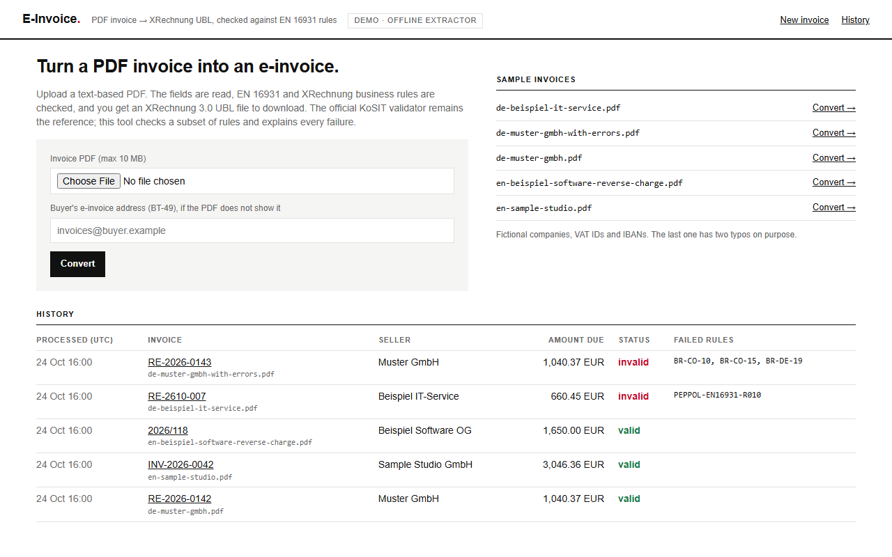
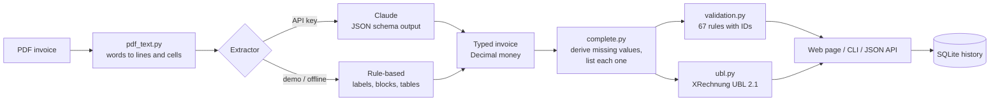

# E-Invoice

[](https://github.com/dushinitspec-ux/e-invoice/actions/workflows/ci.yml)

**[▶ Live demo in your browser](https://site-production-898c.up.railway.app/en/projects/e-invoice/demo)** · [Case study](https://site-production-898c.up.railway.app/en/projects/e-invoice) · Part of [Daniil Dushin's portfolio](https://github.com/dushinitspec-ux/portfolio-daniil)

Turns a PDF invoice into an XRechnung e-invoice (UBL 2.1 XML) and checks it against
EN 16931 and XRechnung business rules. Every failed rule is shown with its official ID and a
plain explanation, for example `BR-CO-10: the lines add up to 882.30, the invoice says 882.80`.

## Problem

Since 1 January 2025, invoices between businesses in Germany have to be e-invoices: a
structured format that follows the European standard EN 16931, not a PDF (§ 14 UStG).
Paper and other formats are still allowed for a transition period: until 31 December 2026,
and until 31 December 2027 for businesses with a previous-year turnover of not more than
800,000 euros (§ 27 Abs. 38 UStG). There is no transition for receiving: every business must
be able to receive e-invoices since 1 January 2025 (BMF FAQ). In the EU, the VAT in the Digital
Age package (adopted by the Council on 11 March 2025) makes e-invoicing mandatory for intra-EU
transactions from 1 July 2030.

Small companies still write invoices in Word or an old accounting tool and send PDFs. A PDF
looks fine to a person and can still be wrong for a machine: totals that do not add up, a
missing buyer reference, a VAT ID without a country prefix, an IBAN with a typo. This tool
reads the PDF, shows what it found, checks the rules a conversion most often breaks, and
writes the XML.

## Features

- **PDF in:** text-based PDFs (pdfplumber). Lines and table columns are rebuilt from word
  positions, so a table row stays a row of cells.
- **Two extractors:**
  - **Claude** (Anthropic API, structured output with a JSON schema): any layout. The model
    is told to copy what is printed and not to fix numbers, because the validator needs the
    seller's own numbers.
  - **Rule-based** (offline, demo mode): German and English labels, DIN 5008 address window,
    "Bill to" blocks side by side, line-item tables found by their header row. Works on the
    bundled sample layouts and on invoices that look like them.
- **Typed model:** seller, buyer, VAT IDs, dates, currency, lines (quantity, unit, net price,
  VAT category and rate), VAT breakdown per rate, totals, IBAN. Money is `Decimal`, rounded
  half up like the official schematron, never a float.
- **Derived values are marked:** if the PDF does not print something EN 16931 needs (e.g. the
  taxable amount per VAT rate), it is computed and listed as *derived*, so "computed" is never
  mistaken for "checked".
- **67 business rules** with their official IDs: 51 from EN 16931 (BR-01 … BR-16, line rules,
  BR-CO-10/13/14/15/16/17/18/25/26, standard rate BR-S-*, reverse charge BR-AE-*, decimals
  BR-DEC-*), 15 from XRechnung 3.0 (BR-DE-*, plus the Peppol rules R010/R020 that the KoSIT
  XRechnung schematron enforces) and 1 own check (due date not before issue date).
- **XRechnung UBL 2.1 out:** `CustomizationID`
  `urn:cen.eu:en16931:2017#compliant#urn:xeinkauf.de:kosit:xrechnung_3.0`, element order of
  the UBL 2.1 schema, business terms mapped as in the official KoSIT examples.
- **Web app** (FastAPI): upload a PDF, see the fields, green and red rules, the XML; download
  it. If the buyer's e-invoice address is missing (it usually is on a PDF), you can type it in
  and the XML is generated again.
- **History** in SQLite: invoice number, seller, amount due, status, failed rules, the XML and
  the original PDF.
- **CLI:** `uv run python -m app convert invoice.pdf -o invoice.xml`.

## Screenshots







## How it works



The extractor only reads. The derivation step fills what the PDF does not print and lists it.
The validator never changes anything; it only reports.

## Quick start (demo, no API key)

Requires [uv](https://docs.astral.sh/uv/) (it installs Python 3.12 itself).

```bash
cp .env.example .env
uv sync
uv run python -m app --demo
```

Open <http://127.0.0.1:8105> and click **Convert →** next to a sample. The last sample,
`de-muster-gmbh-with-errors.pdf`, has a wrong subtotal and a wrong IBAN digit on purpose.
With Docker: `cp .env.example .env && docker compose up --build`.

## Real invoices with Claude

Set `ANTHROPIC_API_KEY` in `.env` and `DEMO_MODE=false`. With `EXTRACTOR=auto` (the default)
Claude is used whenever a key is set. The request sends the PDF text (not the file) and asks
for JSON that matches a fixed schema (`app/extract/claude.py`); the reply is then typed,
derived and validated exactly like the offline result.

## CLI

```bash
uv run python -m app --demo convert samples/de-muster-gmbh.pdf -o out.xml
uv run python -m app convert invoice.pdf --buyer-email invoices@buyer.example
```

It prints the rule results and writes the XML. Exit code `0` = no errors, `1` = the XML was
written but has rule errors, `2` = the PDF could not be read or extraction failed.

## Configuration

See [.env.example](.env.example).

| Variable | Default | Meaning |
|---|---|---|
| `DEMO_MODE` | `true` in the example | Offline rule-based extractor only |
| `EXTRACTOR` | `auto` | `auto`, `rules` or `claude` |
| `ANTHROPIC_API_KEY` | empty | Enables the Claude extractor |
| `ANTHROPIC_MODEL` | `claude-opus-5-5` | Model for extraction |
| `ANTHROPIC_EFFORT` | `medium` | `low` … `max` |
| `DATABASE_PATH` | `data/invoices.db` | SQLite history |
| `SAMPLES_DIR` | `samples` | PDFs offered on the start page |
| `MAX_UPLOAD_MB` / `MAX_PAGES` | `10` / `20` | Upload limits |
| `HOST` / `PORT` | `127.0.0.1` / `8105` | Web server |

## How far the validation goes

The reference is the official **KoSIT validator** (Java), which runs the UBL schema, the CEN
EN 16931 schematron and the XRechnung schematron. This project implements a subset of those
rules in Python, so it can explain each failure next to the extracted values. It does not
replace the official validator.

To see how close the subset is, `scripts/official_check.py` runs the official artefacts on the
XML generated from every sample: the OASIS UBL 2.1 XSD (lxml), the CEN EN 16931 UBL schematron
(validation-1.3.17) and the KoSIT XRechnung schematron (v2.6.0), via Saxon-HE:

```bash
uv run --group official python scripts/official_check.py
```

Result of my last run: all five XML files are valid against the UBL 2.1 schema, and for every
sample the official schematron reports exactly the same rule IDs as this app (none for three
samples; `PEPPOL-EN16931-R010` for the public-sector sample without a buyer e-invoice address;
`BR-CO-10`, `BR-CO-15` and the warning `BR-DE-19` for the sample with errors). An official
KoSIT example invoice is checked as a control and passes. This comparison found two of the bugs
in [BUGFIX.md](BUGFIX.md).

## Design decisions

- **Decimal, half up.** The schematron rounds with XPath `round()`, which rounds halves up.
  Python's `round()` rounds halves to even, and floats cannot hold 2.675 exactly. All money is
  `Decimal` and is rounded with `ROUND_HALF_UP`; SQLite stores it as text.
- **The rule tests, not only the rule texts.** BR-CO-17 accepts a VAT difference below 1.00
  (VAT rounded per line), and BR-CO-13 compares the total without VAT with BT-106, not with
  the sum of the lines. Both details are in the schematron, not in the one-line rule text.
- **Strings in the LLM schema.** Amounts come back as strings, so they become `Decimal`
  without passing through a float; missing values are `""` instead of nullable unions, which
  keeps the schema within the structured-output limits and easy for the model.
- **Copy, do not correct.** A model that "fixes" a wrong total would hide exactly the error the
  validator is there to find.
- **Buyer e-invoice address.** XRechnung needs it (BT-49) and a PDF rarely prints it. The app
  says so and lets you enter it; it never guesses.

## Project structure

```
app/
  pdf_text.py        PDF text layer -> lines and cells (from word positions)
  extract/
    rules.py         offline extractor: labels, address blocks, tables, totals
    claude.py        Claude extractor: JSON schema, prompt, reply -> typed invoice
    complete.py      derived values, each one listed
    parsing.py       dates, units (UN/ECE Rec 20), countries, VAT IDs
  model.py           typed invoice (EN 16931 business terms in comments)
  money.py           Decimal parsing, rounding, formatting
  iban.py            IBAN mod-97 check
  validation.py      67 business rules with IDs
  ubl.py             XRechnung UBL 2.1 writer (lxml)
  pipeline.py        PDF -> extraction -> validation -> XML
  db.py              SQLite history
  web.py, templates/ FastAPI app
  main.py            web server and CLI
samples/             five sample PDFs and generate.py (fpdf2)
scripts/official_check.py   comparison with the official XSD and schematron
tests/               pytest suite
```

## Tests and linting

```bash
uv run pytest
uv run ruff check . && uv run ruff format --check .
```

180 tests. They cover extraction on every sample layout (with the expected values written out,
not imported from the generator), every one of the 67 rules (it passes on a correct invoice and
fails on a broken one, and a test fails if a new rule has no failing case), Decimal rounding
against float rounding, the XML parsed back element by element (including element order and
two-decimal amounts), the Claude extractor with a stub client (request shape, refusals,
malformed replies), the web app (upload, rule results, XML download, the buyer-address fix,
bad uploads), the SQLite history and the CLI exit codes.

Offline conversion of one sample (PDF read, extraction, 67 rules, XML) takes 16–29 ms
(median of 20 runs per sample on my laptop).

## Limitations

- Text-based PDFs only. A scanned invoice has no text layer; there is no OCR.
- The offline extractor knows the bundled layouts and similar ones. For anything else, use
  Claude. [Accuracy of the Claude extractor on real invoices: not measured yet]
- No document-level allowances or charges (discounts, shipping as a separate total), no credit
  notes, one currency per invoice. VAT categories S (standard) and AE (reverse charge) are
  tested; the other codes are only mapped, without their category rules.
- UBL only; the CII syntax (used by ZUGFeRD) is not written.
- A subset of the rules; the KoSIT validator is the reference (see above).
- Docker files are written but were not tested on this machine.

## Sources

- Directive 2014/55/EU (16 April 2014), e-invoicing in public procurement:
  [EUR-Lex](https://eur-lex.europa.eu/eli/dir/2014/55/oj) and the
  [European Commission summary](https://single-market-economy.ec.europa.eu/single-market/public-procurement/digital-procurement/einvoicing_en)
- § 14 and § 27 Abs. 38 UStG:
  [gesetze-im-internet.de/ustg_1980/__14.html](https://www.gesetze-im-internet.de/ustg_1980/__14.html),
  [__27.html](https://www.gesetze-im-internet.de/ustg_1980/__27.html)
- BMF, questions and answers on the mandatory e-invoice:
  [bundesfinanzministerium.de](https://www.bundesfinanzministerium.de/Content/DE/FAQ/e-rechnung.html)
- XRechnung versions (3.0 stays in force until at least 31 July 2027):
  [xeinkauf.de](https://xeinkauf.de/xrechnung/versionen-und-bundles/)
- VAT in the Digital Age adopted:
  [European Commission](https://ec.europa.eu/newsroom/digital/items/877702/)
- Rule texts and tests: [CEN EN 16931 validation artefacts](https://github.com/ConnectingEurope/eInvoicing-EN16931),
  [KoSIT XRechnung schematron](https://github.com/itplr-kosit/xrechnung-schematron),
  [KoSIT XRechnung test suite](https://github.com/itplr-kosit/xrechnung-testsuite)

## Bugs found while building

See [BUGFIX.md](BUGFIX.md).
