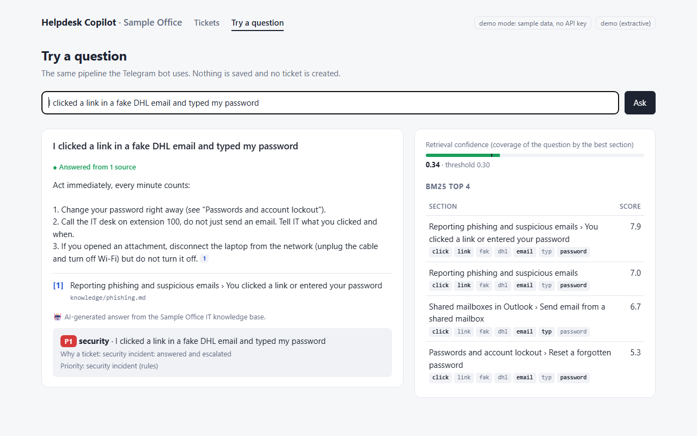
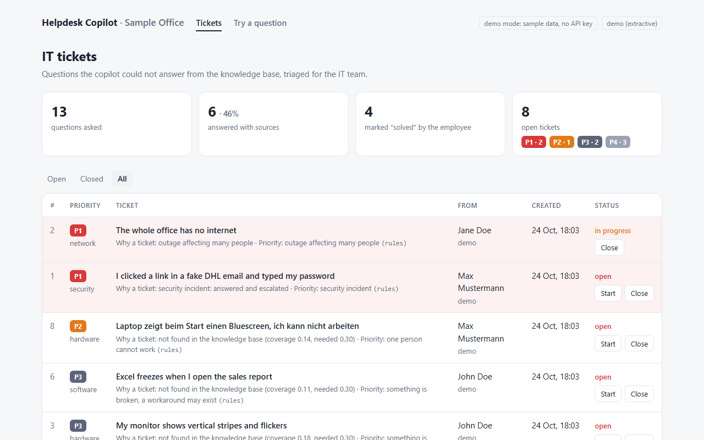
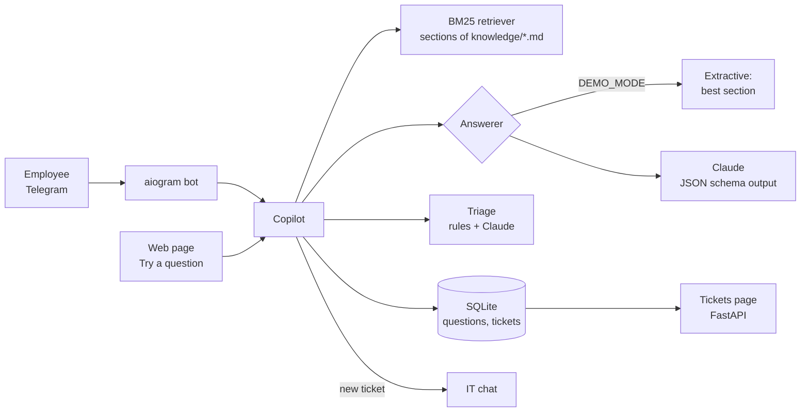
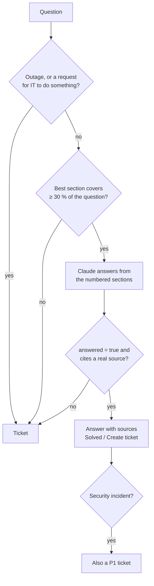

# Helpdesk Copilot

An IT assistant for a small company. Employees ask IT questions in Telegram and get answers
from the company's own IT knowledge base, with numbered sources. A question it cannot answer
from that knowledge base becomes a ticket, sorted into a category and a priority (P1–P4) for
the IT person, who sees all tickets on a small web page.

The company in this repository is **Sample Office**, a fictional 25-person office. Its
15 how-tos in [knowledge/](knowledge/) are sample content written for this project.

## Problem

In a small company, the "IT department" is often one person, or an outside provider paid by
the hour. Half of what reaches them is the same twenty questions: the guest Wi-Fi password,
the VPN from home, a stuck print job, a new phone and MFA. The answers usually already exist
in some how-to that nobody reads.

A chatbot can answer these, but a general chatbot invents plausible steps, settings and phone
numbers that are wrong for *this* company. People act on what an IT assistant says, so a
made-up answer is worse than no answer. This copilot answers only from the company's own
how-tos, shows where each sentence comes from, and passes everything else to a person, with
the urgent things (phishing, an office-wide outage) marked P1.

## Features

- **Knowledge base as Markdown files**: one file per topic, one `## Section` per task. Edit a
  file and restart; no database to maintain.
- **Retrieval without ML dependencies**: BM25 over sections, implemented in ~35 lines, with
  multilingual normalization so German, Russian and Turkish questions find English how-tos.
  Under 0.2 ms per question on this knowledge base (measured by `eval`).
- **Grounded answers with numbered sources**: Claude (Anthropic API, `claude-opus-5-5` by
  default) answers only from the retrieved sections and cites them as [1], [2]. Every
  citation is checked; an answer without a valid source is never shown.
- **Tickets instead of guesses**: low retrieval confidence, "the sources don't answer this",
  or no valid citation → a ticket. Outages and requests for IT to *do* something ("please
  give Anna access…") go straight to a ticket.
- **Triage**: category (access, hardware, network, email, security, software), priority
  P1–P4 with written rules, and a one-line summary. Claude with structured output; the rules
  are the fallback and a floor (the model can raise a priority, never lower a P1).
- **Telegram bot** (aiogram 3): answer + sources, buttons **Solved** / **Create ticket**,
  `/ticket` to open one directly, new tickets posted to the IT chat. `/start` and every
  answer say that this is an AI (see "AI Act transparency").
- **Web page** for the IT person: open tickets by priority, start/close, statistics; and a
  **Try a question** view that shows the answer, the sources and the BM25 ranking behind it.
- **Evaluation**: 30 questions with the expected document, plus a held-out set, and
  `python -m app eval` prints hit@1, hit@3, routing and citation accuracy.
- **Offline demo mode**: extractive answers and rule-based triage, no API key, no Telegram.

## Screenshots





| Answer in Telegram with Solved / Create ticket | Ticket posted in the IT chat |
|---|---|
| [screenshot placeholder] | [screenshot placeholder] |

## How it works



The checks run cheapest first, so most tickets cost no LLM call at all:



**Coverage** is the share of the question's information (IDF-weighted) found in the best
section. BM25 always returns *something*: "the coffee machine is leaking" still matches the
printer section ("next to the kitchen"), but covers only 0.21 of the question, so it becomes
a ticket. A word the knowledge base has never seen gets the highest weight, which is what
pulls such questions down.

`Copilot` holds all of this and knows nothing about Telegram or HTTP, so the bot, the web
page, the evaluation and the tests run the same code.

## Evaluation

[eval/questions.yaml](eval/questions.yaml) has 30 questions written the way people write in a
chat (22 English, 3 German, 3 Russian, 2 Turkish), each with the document that answers it, and
8 questions the knowledge base does not answer. **hit@k** = the expected document is among
the documents of the top-k retrieved sections.

```bash
uv run python -m app eval --ablation
```

Results from that command (demo answerer, thresholds from `.env.example`):

| | Dev set (30 + 8) | Held-out set (15 + 5) |
|---|---|---|
| Retrieval hit@1 | 29/30 (96.7 %) | 14/15 (93.3 %) |
| Retrieval hit@3 | 30/30 (100 %) | 15/15 (100 %) |
| Answered instead of a ticket | 29/30 | 13/15 |
| Answer cites the expected document | 28/29 answered | 13/13 answered |
| Out-of-scope questions routed to a ticket | 8/8 | 5/5 |

**How retrieval got there.** I wrote the 30 questions before writing any retrieval code,
measured, then fixed what the misses showed. Each row adds one step (hit@1 / hit@3):

| Step | Dev set | Held-out |
|---|---|---|
| BM25 on the section text | 18 / 22 | 9 / 13 |
| + document title and section heading indexed | 21 / 25 | 11 / 13 |
| + light English stemming | 22 / 24 | 12 / 13 |
| + DE/RU/TR glossary and suffix fallback | 27 / 29 | 14 / 15 |
| + chat synonyms ("log in" → "sign in", "internet" → "Wi-Fi") | 29 / 30 | 14 / 15 |

Honest notes on these numbers:

- **The dev set was used for tuning**, so its score is optimistic. That is why the held-out
  set exists: 15 + 5 questions written after the first measurement and scored **once**, at
  the end. The chat synonyms, which I added after reading the dev misses, did nothing on it;
  the glossary did.
- Stemming *lowered* dev hit@3 by one question. I kept it because it raised hit@1 on both
  sets.
- Both sets are small and written by me, the same person who wrote the knowledge base.
  Real employees' questions would score lower. [Result on a real helpdesk, e.g. share of
  questions answered without a ticket]
- The remaining misses: an MFA prompt the user did not start ("approval request on my phone")
  ranks the software-request section first, because "request" is frequent there; a Turkish
  question about automatic replies ("otomatik yanıt") is not in the glossary.
- **Answer quality with Claude is not measured here**: it needs an API key and costs money.
  `uv run python -m app eval --llm` runs the same evaluation with Claude as the answerer.
  [Claude eval numbers]

**Known false positives of the demo answerer.** While preparing the demo I found questions
that pass the retrieval gate with the wrong section: "My laptop does not turn on after the
Windows update" (matched Teams › Share your screen on *window* and *turn*), "Outlook crashes
every time I open a PDF attachment" (matched the phishing section on *open* and
*attachment*), "My laptop shows a blue screen on every start" (matched the guest Wi-Fi
section on *screen* and *start*). BM25 counts words, it does not understand them. With Claude
these are meant to be caught by `answered: false`; in demo mode they show the wrong how-to.

## Triage rules

| Priority | Rule (first match wins) | Examples |
|---|---|---|
| **P1** | Security incident, or many people cannot work | phishing, clicked a link / typed my password, malware, lost or stolen device, an MFA request I did not start; "whole office", "nobody can", "server down" |
| **P2** | One person cannot work at all | locked out, can't log in, laptop won't turn on, no internet, blue screen, urgent |
| **P3** | Something is broken, there may be a workaround | jammed, slow, error, freezes, missing |
| **P4** | A request or a question | "can I get…", "how do I…", "please install…" |

Keywords are matched at the start of words on folded text (no case, no accents), in English,
German, Russian and Turkish. With Claude, the model triages from the same written rules, and
the rules keep the last word on P1.

## AI Act transparency

The bot's `/start` message says "I'm an AI system, not a person", and every answer ends with
"AI-generated answer from the Sample Office IT knowledge base."

Article 50(1) of the EU AI Act (Regulation (EU) 2024/1689) requires providers of AI systems
that interact directly with people to make sure those people are "informed that they are
interacting with an AI system", unless it is obvious from the context. Article 50(5) requires
this information to be clear and distinguishable, at the latest at the first interaction.
Under Article 113 the Regulation applies from 2 August 2026; Chapter IV, which contains
Article 50, is not among the earlier or later dates.

Checked on 24 October 2026 on the European Commission's AI Act Service Desk, which shows the
consolidated EUR-Lex text: [Article 50](https://ai-act-service-desk.ec.europa.eu/en/ai-act/article-50),
[Article 113](https://ai-act-service-desk.ec.europa.eu/en/ai-act/article-113). Official
text on EUR-Lex: <https://eur-lex.europa.eu/eli/reg/2024/1689/oj>. This is an engineering
note, not legal advice.

## Quick start (offline demo, no keys)

Requires [uv](https://docs.astral.sh/uv/) (it installs Python 3.12 itself).

```bash
cp .env.example .env
uv sync
uv run python -m app --demo        # http://127.0.0.1:8106
uv run python -m app eval          # the evaluation above
```

Demo mode runs 13 sample questions from placeholder employees through the real pipeline, so
the ticket page has content. `uv run python -m app --demo ask "Wie lautet das WLAN-Passwort für Gäste?"`
answers one question in the terminal. With Docker: `docker compose up --build` (the Docker
files mirror the other projects but were not run: Docker is not installed on my machine).

## Run with Claude and Telegram

1. In `.env` set `DEMO_MODE=false` and `ANTHROPIC_API_KEY`.
2. Create a bot with [@BotFather](https://t.me/BotFather) and set `BOT_TOKEN`.
3. Send `/id` to the bot in the chat where IT should receive tickets (the IT person's private
   chat or a group) and put the number in `IT_CHAT_ID`.
4. Replace the files in `knowledge/` with your own how-tos (format in
   [knowledge/README.md](knowledge/README.md)) and add questions to `eval/questions.yaml`.
5. `uv run python -m app`, or `docker compose up -d --build`.

## Configuration

See [.env.example](.env.example); every variable has a comment.

| Variable | Default | Meaning |
|---|---|---|
| `DEMO_MODE` (or `DEMO`) | `false` (`true` in the example) | Offline: extractive answers, rule triage, sample tickets |
| `ANTHROPIC_API_KEY` | empty | Needed when demo mode is off |
| `ANTHROPIC_MODEL` | `claude-opus-5-5` | Model for answers and triage |
| `ANTHROPIC_EFFORT` / `ANTHROPIC_TRIAGE_EFFORT` | `medium` / `low` | Effort for answers / for triage |
| `BOT_TOKEN` | empty | Telegram bot; without it only the web page runs |
| `IT_CHAT_ID` | empty | Chat that receives new tickets |
| `COMPANY_NAME` | `Sample Office` | Used in the prompts and the bot's texts |
| `KNOWLEDGE_DIR` | `knowledge` | Folder with the how-tos |
| `TOP_K` | `4` | Sections given to the model as sources |
| `MIN_COVERAGE` / `MIN_SCORE` | `0.3` / `2.0` | Below these, a ticket without an LLM call |
| `DATABASE_PATH` | `data/helpdesk.db` | SQLite file |
| `HOST` / `PORT` | `0.0.0.0` / `8106` | Web page |
| `TIMEZONE` | `Europe/Berlin` | Times on the web page |

## Design decisions

- **BM25, not embeddings.** For a few dozen pages, BM25 is fast, needs no model download or
  vector database, and its decisions can be shown on screen (the matched words in the Try
  view). The weak spot is synonyms and other languages, which the glossary covers for the
  four languages the office uses. Embeddings via an API would be the next step if the
  knowledge base grew or the held-out score dropped.
- **Sections, not fixed-size chunks.** A how-to section is one task, so the source a person
  sees ("VPN for remote work › VPN does not connect") is something they can open and follow.
- **Two gates before an answer is shown**: retrieval confidence (no LLM call for questions
  the knowledge base cannot support) and the model's own `answered` flag in a JSON schema,
  then a citation check in code. The worst case is a ticket, never an invented answer.
- **Rules as a floor for triage.** An LLM is good at categories and summaries in any
  language, but a missed phishing report is expensive. A rule-based P1 cannot be lowered.
- **Claude without fixed thinking settings.** Opus 5.5 always thinks; `effort` is the control.
  Answers use `medium`, triage uses `low`. Refusals fall back server-side
  (`fallbacks: "default"`); any API error falls back to the extractive answer and the rules.
- **Employee text is data.** The prompts wrap it in `<question>` / `<ticket>` and say to
  treat it as a question, never as instructions.
- **Only the asker can press their buttons.** A callback for someone else's question is
  refused, and "Create ticket" twice returns the same ticket.

## Project structure

```
app/
  copilot.py     the decision: answer with sources or ticket
  retrieval.py   BM25 and the coverage-based confidence
  text.py        folding, stemming, stopwords, DE/RU/TR glossary, chat synonyms
  knowledge.py   Markdown files -> documents -> sections
  citations.py   numbered sources, [n] parsing and checking
  triage.py      categories, P1-P4 rules, summary, the P1 floor
  llm/           Claude client (JSON schema output), demo answerer, prompts
  bot.py         aiogram handlers and buttons; messages.py has the texts
  web.py         FastAPI: tickets page, Try a question, JSON API; templates/
  db.py          SQLite: questions and tickets
  evaluate.py    hit@k, routing and citation metrics, ablation
  demo.py        sample questions for demo mode
  main.py        command line: serve, eval, ask
knowledge/       the sample IT knowledge base (15 how-tos)
eval/            questions.yaml: dev set, held-out set, out-of-scope questions
tests/           pytest suite
```

## Tests and linting

```bash
uv run pytest
uv run ruff check . && uv run ruff format --check .
```

95 tests cover text normalization in four alphabets, section parsing, BM25 ranking (IDF,
saturation, length normalization), retrieval on real questions, citation parsing and
checking, every routing path (low confidence, the model declining, invalid citations, LLM
failure, security incidents, outages, action requests), the triage rules and the P1 floor,
the Claude client against a fake HTTP server (request shape, schemas, refusals, errors), the
bot end to end through aiogram's dispatcher with a fake Telegram session (answers, buttons,
someone else's button, the IT notification, `/ticket`), the web page and JSON API, and the
evaluation numbers above as a regression guard.

## Limitations

- The demo answerer quotes the best section; it cannot rephrase, combine sections or answer
  in the question's language. Claude can.
- Retrieval confidence is a word-overlap measure; see the false positives above.
- The glossary covers common IT words in German, Russian and Turkish, not every phrasing.
- The bot's fixed texts (welcome, ticket messages) are in English only.
- The ticket page has no login. Run it inside the company network or behind a reverse proxy
  with authentication.
- No notification back to the employee when IT closes a ticket.

## Bugs found while building

See [BUGFIX.md](BUGFIX.md).

## Next steps

- Measure answer quality with Claude on the evaluation set (`eval --llm`).
- Tell the employee in Telegram when their ticket is closed.
- Show IT which questions most often end as tickets, as a list of how-tos to write next.
