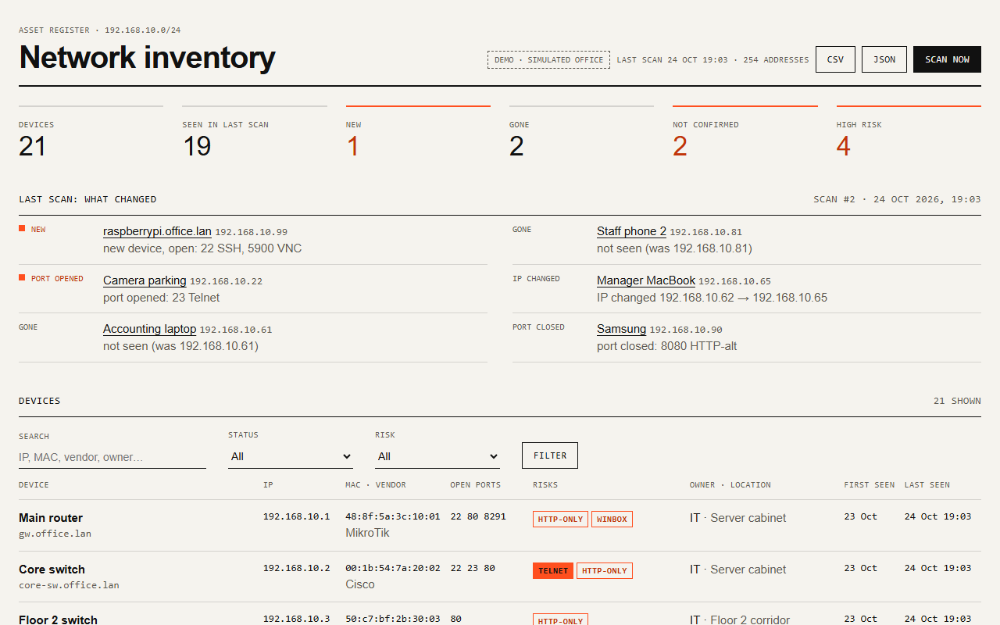
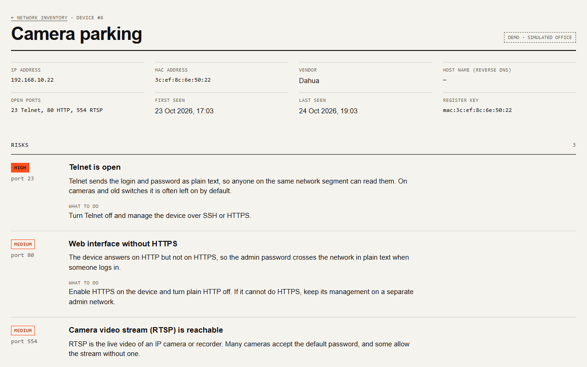
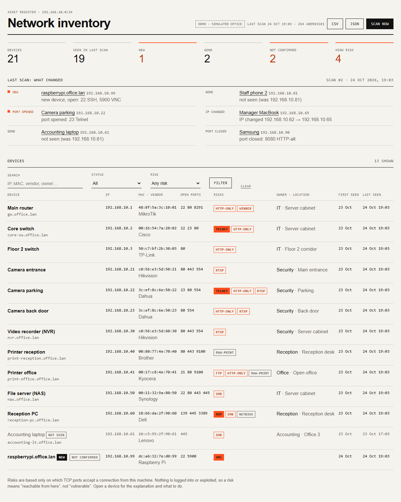
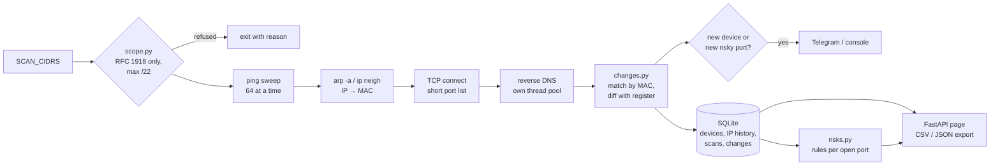

# Network Inventory

Finds the devices on an office or hotel network, keeps a register of them over time, and tells
you what changed: a new device, a device that disappeared, a port that opened. Each device gets
risk notes based on its open services (Telnet, FTP, RDP, SMB, plain-HTTP admin pages, camera
streams), with a plain explanation and what to do. The register exports to CSV and JSON.

## Problem

Ask a small hotel or office what is connected to its network and the honest answer is usually
"we don't know". Cameras, recorders, printers, access points and the PC someone set up for
remote support years ago all sit on the same flat network. Nobody notices a new device, and
nobody knows that a camera answers on Telnet after a factory reset.

The EU's NIS2 Directive ([Directive (EU) 2022/2555](https://eur-lex.europa.eu/eli/dir/2022/2555/oj))
lists "asset management" among the minimum cybersecurity risk-management measures, in
Article 21(2)(i). The directive applies to medium-sized and larger entities in the sectors of
its Annexes I and II (Article 2(1)), plus some entities regardless of size, such as DNS
service providers or public administration (Article 2(2)). Many small businesses are outside
its scope. A list of what is on the network is still the first step of any security work,
required or not.

This tool helps you keep that list. It does not make anyone NIS2-compliant: compliance is a
set of organisational and technical measures, and an inventory is one input to them.

## Scan only networks you are allowed to scan

A ping sweep and a port probe of someone else's network can be illegal and will trip their
intrusion detection. The tool is built to make that hard to do by accident:

- **The target must be explicit.** There is no "scan whatever I am connected to": without
  `SCAN_CIDRS` (or `--cidr`) it refuses to start.
- **Private ranges only.** RFC 1918 (`10/8`, `172.16/12`, `192.168/16`) and loopback.
  Anything else, including the carrier-grade NAT range `100.64/10` shared with other ISP
  customers, is refused unless you set `ALLOW_PUBLIC=1` for a range you own.
- **Size cap.** Networks larger than `/22` (1022 hosts) are refused (`SUBNET_LIMIT`).
- **Observation only.** Ping, the OS neighbour table, a TCP connect that is closed at once,
  and reverse DNS. No logins, no payloads, no version probes, no exploits.
- **IPv4 only**, and no raw sockets: it runs without admin or root rights.

```
$ uv run python -m app scan --cidr 8.8.8.8/32
Refusing to scan: 8.8.8.8/32 is not a private (RFC 1918) range. Scan only networks you are
allowed to; set ALLOW_PUBLIC=1 if you really own this range.
$ uv run python -m app scan --cidr 10.0.0.0/16
Refusing to scan: 10.0.0.0/16 has 65534 hosts; the limit is /22. Split it into smaller
networks or raise SUBNET_LIMIT.
```

## Features

- **Discovery with asyncio:** ping sweep with the system `ping` command (parsed in any
  Windows language and on Linux/macOS), then the neighbour table (`arp -a` on Windows,
  `ip neigh` on Linux) for MAC addresses, so devices that drop ping still show up. TCP connect
  to a short port list on every live host. Reverse DNS for host names. Concurrency limits and
  timeouts on every step.
- **MAC vendor lookup** from a bundled 133 KB extract of the IEEE OUI list (71 vendors common
  on office and hotel networks). Randomised (locally administered) MACs of phones, laptops
  with private Wi-Fi addresses and virtual machines are marked as such instead of getting a
  wrong vendor.
- **Asset register in SQLite:** first seen, last seen, IP history, MAC, vendor, host name,
  open ports, and editable name, owner, location, notes and a "confirmed" flag.
- **Diff between scans:** new device, device gone, device back, IP changed, port opened,
  port closed. Devices are tracked by MAC, so a new DHCP address is not a new device.
- **Risk rules with explanations** for Telnet, FTP, RDP, SMB, NetBIOS, VNC, RTSP, MikroTik
  Winbox, raw printing and web interfaces without HTTPS.
- **Web page** (FastAPI, server-rendered, no JavaScript): device table with search and
  status/risk filters, risk badges, the last scan's changes, a page per device with its risks,
  IP history and an edit form. CSV and JSON export of the register.
- **Telegram alert** (aiogram 3, optional) on a new device or a newly opened risky port. One
  message per scan, never one per device; the very first scan sends a summary only.
- **Demo mode:** a simulated office of 21 devices scanned twice, so diffs and risks show.

## Screenshots

All three are from demo mode (simulated office network, sample data).







| Telegram alert |
|---|
| [screenshot placeholder] |

## How it works



Matching and diffing are pure functions with no I/O, which keeps them easy to test:

- A device is identified by its **MAC address**. If the MAC is not visible (the scanning
  machine itself, or a host behind a router), the IP address is used until a MAC appears,
  and then the entry is re-keyed instead of duplicated.
- **Ports are compared with the device's last sighting**, even if that was weeks ago, so a
  laptop that comes back with RDP enabled is reported.
- A device only counts as **gone** if its last IP is inside the networks this scan covered.
  Scanning another subnet does not make the first one disappear.
- A scan is stored in **one transaction**: a scan that fails halfway leaves nothing behind.

## Quick start (demo, no network access)

Requires [uv](https://docs.astral.sh/uv/) (it installs Python 3.12 itself).

```bash
cp .env.example .env
uv sync
uv run python -m app --demo
```

Open <http://127.0.0.1:8107>. The demo office has a router, switches, access points, cameras,
an NVR, printers, a NAS, PCs, an IP phone, a TV and two staff phones. Between the two scans a
Raspberry Pi with VNC appears, a camera starts answering on Telnet, a laptop and a phone leave
and the MacBook gets a new IP. The alert for the second scan is printed in the terminal.

## Scan a real network

1. Make sure you are allowed to scan it.
2. In `.env` set `DEMO_MODE=false` and `SCAN_CIDRS=192.168.1.0/24` (your network).
3. Optional: `BOT_TOKEN` and `ALERT_CHAT_ID` for Telegram (create a bot with
   [@BotFather](https://t.me/BotFather) and add it to a group).
4. `uv run python -m app` - the page plus a scan every `SCAN_INTERVAL_MIN` minutes. Or one
   scan in the terminal: `uv run python -m app scan`.

Run it on a machine inside the network (a mini PC or a Raspberry Pi is enough): ARP only sees
the local segment, so for other VLANs the tool shows IPs and ports but no MAC or vendor.

## Configuration

Every variable is in [.env.example](.env.example) with a comment.

| Variable | Default | Meaning |
|---|---|---|
| `DEMO_MODE` (or `DEMO`) | `false` (`true` in the example) | Simulated office, no scanning |
| `SCAN_CIDRS` | empty | Networks to scan, comma-separated. Required outside demo |
| `ALLOW_PUBLIC` | `false` | Allow non-RFC 1918 ranges (only ones you own) |
| `SUBNET_LIMIT` | `22` | Largest allowed network, as a prefix length |
| `SCAN_PORTS` | `21,22,23,80,139,443,445,554,3389,5900,8080,8291,8443,9100` | TCP ports to probe |
| `SCAN_INTERVAL_MIN` | `60` | Minutes between scans; `0` = only on request |
| `PING_TIMEOUT_S` / `TCP_TIMEOUT_S` / `DNS_TIMEOUT_S` | `1` / `1` / `2` | Timeouts per probe |
| `REVERSE_DNS` | `true` | Look up host names |
| `MAX_PARALLEL_PINGS` / `MAX_PARALLEL_CONNECTS` | `64` / `128` | Concurrency limits |
| `BOT_TOKEN` / `ALERT_CHAT_ID` | empty | Telegram alerts; console if empty |
| `DATABASE_PATH` | `data/inventory.db` | SQLite file (demo mode keeps data in memory) |
| `HOST` / `PORT` | `127.0.0.1` / `8107` | Web page address |
| `TIMEZONE` | `Europe/Istanbul` | Times on the page and in alerts |

The page has **no login** and lists the weak spots of your network. Keep `HOST=127.0.0.1`, or
put it behind a reverse proxy with authentication before opening it to the LAN.

## Risk rules

Only what a TCP connect can observe: "this port accepted a connection from the scanning
machine". A rule never says a device *is* vulnerable, only what to check.

| Port | Rule | Severity | Why it matters |
|---|---|---|---|
| 23 | `telnet` | high | Login and password in plain text; often on by default on cameras and old switches |
| 3389 | `rdp` | high | Password guessing on RDP is a common way ransomware spreads inside a network |
| 5900 | `vnc` | high | Often a weak password or none, often unencrypted |
| 21 | `ftp` | medium | Passwords and files unencrypted (printers' scan-to-folder, old NAS backups) |
| 445 | `smb` | medium | How worms like WannaCry spread; should not be reachable from guest or camera networks |
| 554 | `rtsp` | medium | Live camera video; default passwords are common |
| 8291 | `winbox` | medium | Full control of a MikroTik router; restrict to the admin network |
| 80 / 8080 without 443 / 8443 | `http-only` | medium | Admin password crosses the network in plain text |
| 139 | `netbios` | low | Old Windows file sharing, leaks computer and user names |
| 9100 | `raw-print` | low | Anyone on the network can print; printers run old firmware |

The device page shows each rule's explanation and the fix. The rules are in
[app/risks.py](app/risks.py).

## MAC vendor data

[app/resources/oui.csv](app/resources/oui.csv) is an extract of the **IEEE Registration
Authority MA-L public listing** (<https://standards-oui.ieee.org/oui/oui.csv>), downloaded on
24 Oct 2026: 9 695 prefixes of 71 vendors common on office and hotel networks (network gear,
cameras, printers, NAS, PCs and their Wi-Fi chips, phones, IoT boards, virtual machines), with
short names and no addresses. The full list has 40 397 MA-L entries and 3.8 MB.

IEEE publishes the listing openly; I found no separate licence for it, so IEEE's site terms
apply, the source is credited here and in the file header, and only the prefix and a short
vendor name are kept. Rebuild or extend it with
[scripts/build_oui.py](scripts/build_oui.py). Prefixes outside the extract show as
"unknown vendor"; MA-M and MA-S (smaller blocks) are not included.

## Design decisions

- **System `ping`, not raw ICMP:** raw sockets need admin or root rights. A reply counts only
  with exit code 0 **and** a `TTL=` in the output, because Windows exits with 0 when it
  answers "Destination host unreachable" itself - which in a sweep is the answer for every
  empty address.
- **Output is decoded as ASCII.** On a Russian Windows `ping` and `arp` print in code page
  cp866; the words become unreadable, but `TTL=`, IP and MAC addresses are ASCII in every
  language. One neighbour-table parser handles Windows (any language), Linux and macOS. This
  is the lesson from [project 03's bug 1](../03-uptime-monitor/BUGFIX.md).
- **The neighbour table is read after the sweep:** the pings are what fill it, and a Windows
  PC that drops ping still answers ARP.
- **Reverse DNS has its own thread pool** whose slots are freed only when a lookup really
  ends (see [BUGFIX.md](BUGFIX.md), bug 1).
- **CSV export is safe for Excel:** cells that start with `=`, `+`, `-` or `@` are prefixed
  with `'`, because owner, notes and host names (from PTR records) are not trusted. The file
  starts with a UTF-8 BOM so Excel shows Cyrillic and Turkish notes correctly.
- **One process:** the scan loop and the page share the event loop and the database; a lock
  stops an edit from committing a half-written scan, and only one scan runs at a time.

## Project structure

```
app/
  scope.py        what may be scanned: RFC 1918, size cap, explicit target
  parsing.py      ping / arp / ip neigh output in any language
  discovery.py    ping sweep, neighbour table, TCP connect, reverse DNS
  oui.py          MAC normalising, vendor lookup, randomised MACs
  changes.py      matching observations to the register, diff (pure)
  risks.py        risk rules with explanations (pure)
  db.py           SQLite register: devices, IP history, scans, changes
  inventory.py    one scan end to end, scan lock, alerts
  messages.py     alert text
  export.py       CSV / JSON
  web.py          FastAPI routes; templates/ has the HTML
  demo.py         simulated office network
  main.py         CLI: serve, --demo, scan
  resources/oui.csv   vendor extract (see above)
scripts/build_oui.py  rebuilds the vendor extract from the IEEE file
tests/                pytest suite; fixtures/ has real Windows output
```

## Tests and linting

```bash
uv run pytest
uv run ruff check . && uv run ruff format --check .
```

107 tests. They cover ping and neighbour-table parsing with **real output from a Russian
Windows 11** (`ping` of 127.0.0.1 and the router, `arp -a`, stored as raw cp866 bytes; only
the last three bytes of the MAC addresses were replaced) next to English Windows, Linux and
macOS samples; the scope rules and size caps; MAC normalising, vendor lookup and randomised
MACs; identity matching and the diff; every risk rule; the scan pipeline with SQLite
(transactions, alerts, Telegram failure, overlapping scans, edits that survive rescans);
discovery against a local TCP server; reverse-DNS starvation; CSV/JSON export (including
formula injection); the web page, filters, edit form and API; settings.

## Real run

I tested discovery only against this machine and its default gateway, with two ports:

```
$ uv run python -m app scan --cidr 127.0.0.1/32,192.168.1.1/32 --ports 80,443

Scan #1 of 127.0.0.1/32, 192.168.1.1/32: 2 addresses, 2 devices, 2.0 s
  127.0.0.1       -                  -                Danya                        ports: -                risks: -
  192.168.1.1     8c:86:dd:xx:xx:xx  TP-Link          EX530V                       ports: 80 443           risks: -
First scan: every device is new.
```

(MAC shortened here.) The router was found by ping and ARP, its vendor and name resolved, and
its web interface answered on 80 and 443. A second scan reported no changes. A scan of these
two addresses took 2.0 to 3.0 s over several runs, and most of it is waiting: a closed port
on localhost (Windows reports "refused" only after 2.04 s, so the 1 s timeout ends it) and up
to 1.3 s for the router's reverse lookup.

To check the concurrency limits on a full `/22` without touching the LAN, I swept the
loopback range `127.0.0.0/22` (every address is this machine) with two ports and reverse DNS
off: **1022 addresses in 22.0 s**.

## Docker

`docker compose up -d --build` with `.env` set as above. Discovery needs the **host network**
(`network_mode: host` in [docker-compose.yml](docker-compose.yml)): in Docker's default bridge
network the container's ARP table contains only Docker's own gateway, so there would be no MAC
addresses and no vendors. Host networking works on a Linux host, not in Docker Desktop on
Windows or macOS. The image installs `iputils-ping` and `iproute2`. Docker is not installed on
my development machine, so the Dockerfile and compose file have not been built or run yet.

## Limitations

- **Only what is reachable from the scanner.** Firewalls, client isolation on guest Wi-Fi and
  VLANs hide devices; the risk notes describe reachability from where the scanner runs.
- **Randomised MACs** of phones can change (per network, or periodically on newer Android and
  iOS versions), so the same phone may appear as a new device. They are labelled, and the
  first-scan summary avoids an alert storm, but expect some noise from phones.
- **ARP entries linger** for a short while after a device leaves, so "gone" can lag one scan.
- **TCP only, short port list.** UDP services (SNMP, UPnP, SIP) are not probed.
- **No login on the page.** See Configuration.
- Tested on Windows 11; the Linux and macOS parsers are tested with format samples, not on
  real machines.

## Bugs found while building

See [BUGFIX.md](BUGFIX.md).
