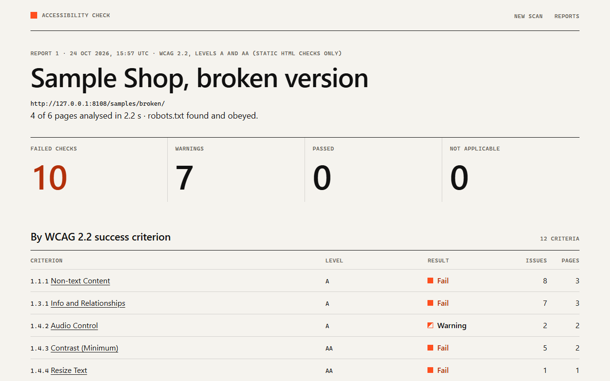
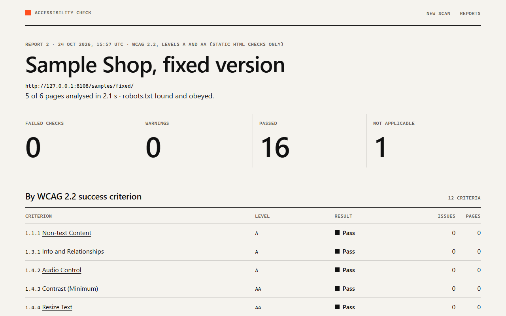
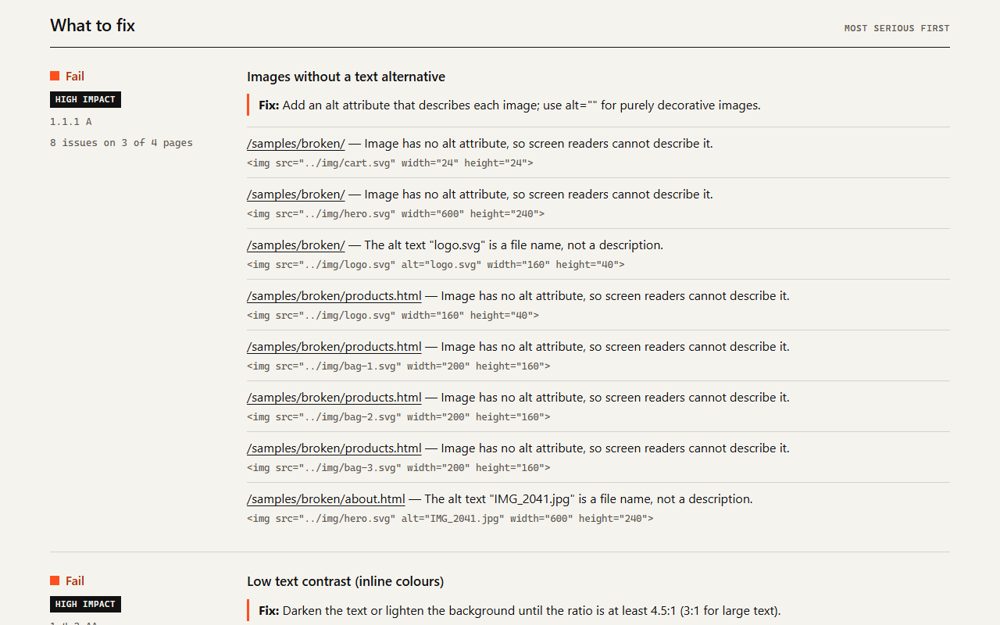
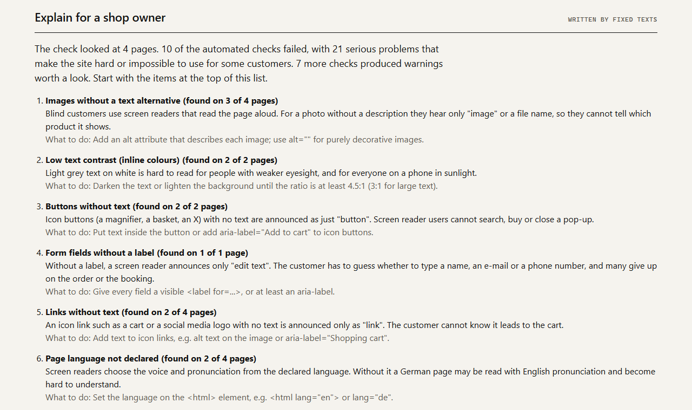
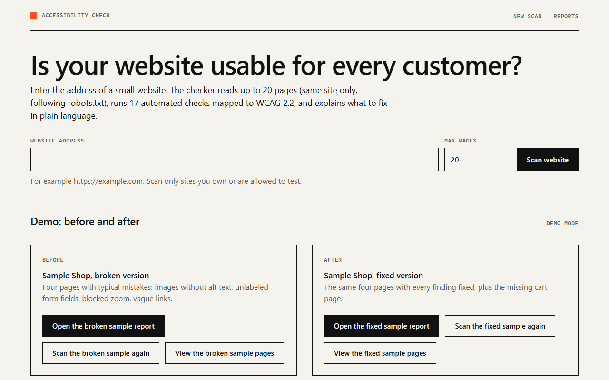
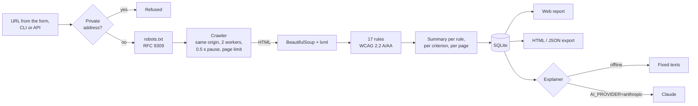

# Accessibility Check

[](https://github.com/dushinitspec-ux/accessibility-check/actions/workflows/ci.yml)

**[▶ Live demo in your browser](https://site-production-898c.up.railway.app/en/projects/accessibility-check/demo)** · [Case study](https://site-production-898c.up.railway.app/en/projects/accessibility-check) · Part of [Daniil Dushin's portfolio](https://github.com/dushinitspec-ux/portfolio-daniil)

Crawls a small website, runs 17 automated checks on the HTML of every page, maps each finding
to a WCAG 2.2 success criterion, and says in plain language what to fix. Reports are stored in
SQLite and can be downloaded as a standalone HTML file or as JSON. An optional Claude summary
explains the result to a shop owner who does not know what "WCAG" means.

It is a **first report**, not an audit: static HTML checks cover only part of WCAG (see
[What it cannot check](#what-it-cannot-check)).

## Problem

The European Accessibility Act, [Directive (EU) 2019/882][eaa], applies from **28 June 2025**
(Art. 31). Among other services it covers **e-commerce services** provided to consumers
(Art. 2(2)(f)): selling online through a website or an app. The Directive asks for websites that
are "perceivable, operable, understandable and robust" (Annex I) and gives a presumption of
conformity to harmonised standards cited in the Official Journal (Art. 15). The European
standard for this is EN 301 549; its version [V4.1.1 (2026-09)][en301549] was prepared for the
Act and aligns its web requirements with [WCAG 2.2][wcag22] levels A and AA. Microenterprises
that provide services (fewer than 10 people and at most EUR 2 million turnover or balance sheet)
are exempt (Art. 4(5), Art. 3(23)).

A small online shop or a hotel with a booking form usually has no idea where its website
stands. Professional audits cost money, and browser extensions such as axe check one page at a
time and speak developer language. This tool crawls the whole small site in seconds, groups the
findings by WCAG criterion, and gives one clear "what to fix" line per problem, so the owner has
something concrete to hand to their web developer.

It does **not** say whether the law applies to a business or whether a site complies with it.

## Features

- **Polite crawler** (httpx, asyncio): one start URL, same origin only, robots.txt obeyed
  ([RFC 9309][rfc9309], including `*`/`$` wildcards and Crawl-delay), page limit (default 20),
  2 parallel requests with a 0.5 s pause, redirects followed hop by hop, status codes recorded.
- **17 rules on the HTML** (BeautifulSoup + lxml), each with its WCAG 2.2 criterion, level,
  severity and a one-line fix. 10 are failures, 7 are advisory (best practice or heuristics).
- **Real contrast maths**: WCAG relative luminance and contrast ratio, for text whose colour and
  background are both set inline. `#777` on white is 4.48:1 and fails; `#767676` is 4.54:1 and
  passes.
- **Report** by WCAG criterion, by rule and per page, with the HTML snippet of each finding.
  Download as a self-contained HTML file (inline CSS, no scripts) or JSON. Stored in SQLite.
- **Shop-owner summary**: offline fixed texts per rule, or Claude (Anthropic API) in English,
  German, Russian or Turkish, with structured output and a fallback to the fixed texts.
- **CLI** for scripts and CI: `uv run python -m app scan https://example.com --max-pages 10`.
- **Demo mode** with a deliberately broken "Sample Shop" and its fixed version, served by the
  app itself and scanned in-process, so the before/after works offline.
- **Safe to deploy**: URLs that resolve to private, loopback or link-local addresses are refused
  (no scanning of the server's own network), checked again on every redirect to a new host.

## Screenshots

| Before: the broken sample shop | After: the fixed version |
|---|---|
|  |  |







## How it works



Each rule returns how many elements it looked at and what it found. That gives three outcomes
per page: **fail** (or **warning** for advisory rules), **pass**, and **not applicable** (no
images on the page, say). A criterion takes the worst status of its rules.

## What is checked

| Rule | WCAG 2.2 | Level | Type |
|---|---|---|---|
| Images without a text alternative (missing `alt`, file name as `alt`) | 1.1.1 | A | failure |
| Form fields without a label | 1.3.1, 4.1.2 | A | failure |
| Labels pointing to a duplicated id | 1.3.1, 4.1.2 | A | failure |
| Missing or empty page title | 2.4.2 | A | failure |
| Page language not declared or not a valid language code | 3.1.1 | A | failure |
| Links without text (icon links) | 2.4.4, 4.1.2 | A | failure |
| Buttons without text | 4.1.2 | A | failure |
| `<iframe>` without a title | 4.1.2 | A | failure |
| Viewport meta that blocks zoom (`user-scalable=no`, `maximum-scale` < 2) | 1.4.4 | AA | failure |
| Text contrast, where colour and background are both inline | 1.4.3 | AA | failure |
| Vague link texts ("click here", "mehr", "подробнее", "devamı" ... in 6 languages) | 2.4.4 | A | advisory |
| Fields labelled only by a placeholder | 3.3.2 | A | advisory |
| Several pages with the same title | 2.4.2 | A | advisory |
| Heading structure: no `<h1>`, skipped levels, empty headings | 1.3.1 | A | advisory |
| No `<main>` landmark and no skip link, or a broken skip link | 2.4.1 | A | advisory |
| Audio or video that plays by itself without `muted` | 1.4.2 | A | advisory |
| Duplicate ids | 4.1.1 (removed) | – | advisory |

Notes on the less obvious ones:

- **Duplicate ids.** WCAG 2.2 marks 4.1.1 Parsing as "obsolete and removed": assistive technology
  no longer parses HTML itself, and EN 301 549 V4.1.1 lists the clause as "Void". So a duplicate
  id on its own is only a best practice here. When a `<label for>` or `aria-labelledby` points to
  a duplicated id, the label may land on the wrong field, and that is reported as a failure under
  1.3.1 and 4.1.2.
- **Vague link texts** are advisory because 2.4.4 is "in context": "Read more" passes if the
  sentence around it says where the link goes. An `aria-label` that names the target passes.
- **Contrast** uses the WCAG 2.2 definition of relative luminance (sRGB, threshold 0.04045) and
  the 4.5:1 / 3:1 thresholds. Large text (24 px, or 18.66 px bold) is recognised only from an
  inline `font-size`; otherwise the message says that 3:1 would be enough if the text is large.
  Semi-transparent text is blended over the background; a background image or gradient makes the
  backdrop unknown, so that text is skipped rather than guessed.
- **Accessible names** follow a simplified version of the W3C computation: `aria-labelledby`,
  `aria-label`, `alt` or `<label>`, the element's text (for links, buttons, headings), `title`.

## What it cannot check

Static HTML checks see the markup, not the rendered page. They cannot judge:

- colour contrast from stylesheets, images, hover and focus states;
- keyboard use and keyboard traps (2.1.1, 2.1.2), focus order, visible focus and focus hidden
  behind sticky headers (2.4.3, 2.4.7, 2.4.11);
- what a screen reader really announces, and content added by JavaScript;
- whether alt texts, labels and headings are *meaningful*, only whether they exist;
- captions, transcripts, text in images, reflow at 320 px, motion, PDFs.

A clean report is a good start, not proof of accessibility or of compliance with any law. Test
with a keyboard and a screen reader (NVDA, VoiceOver), and use tools that render the page, such
as axe DevTools or Lighthouse, for the rest.

## Quick start (demo, offline)

Requires [uv](https://docs.astral.sh/uv/) (it installs Python 3.12 itself).

```bash
cp .env.example .env
uv sync
uv run python -m app --demo
```

Open <http://127.0.0.1:8108>. In demo mode the app scans its two sample shops at start-up
(about 2 seconds each), so both reports are ready, and the shop-owner summary uses the fixed
offline texts. The sample pages themselves are at `/samples/broken/` and `/samples/fixed/`.
`DEMO_MODE=true` in `.env` (or `DEMO=1`) does the same as `--demo`.

With Docker: `cp .env.example .env && docker compose up --build` (the Dockerfile and compose
file follow the other projects in this repository but were not run on this machine, which has
no Docker).

## Scan a real website

From the browser: enter the address on the start page. From the terminal:

```bash
uv run python -m app scan https://example.com --max-pages 10 --json report.json --html report.html
uv run python -m app scan --sample broken --explain      # the offline demo, in the terminal
```

The CLI prints a summary per criterion and per failed rule, writes the exports, and stores the
report in the same SQLite database as the web UI. Exit code 0 = scan finished, 1 = scan failed,
2 = the URL was refused.

Scan only sites you own or are allowed to test. The crawler identifies itself as
`AccessibilityCheckBot` and obeys robots.txt.

### JSON API

```bash
curl -X POST http://127.0.0.1:8108/api/scans -H "content-type: application/json" \
     -d '{"url": "https://example.com", "max_pages": 10}'
# {"id": 4, "status": "running", "report": "/api/scans/4"}
curl http://127.0.0.1:8108/api/scans/4
```

## Configuration

All variables are in [.env.example](.env.example) with comments.

| Variable | Default | Meaning |
|---|---|---|
| `DEMO_MODE` (or `DEMO`) | `false` (`true` in the example) | Scan the sample shops at start-up; fixed texts only |
| `MAX_PAGES` | `20` | Requests per scan (the form and CLI can change it, up to 200) |
| `CONCURRENCY` | `2` | Parallel requests to the scanned site |
| `REQUEST_DELAY_S` | `0.5` | Pause after each request; a robots.txt Crawl-delay overrides it |
| `REQUEST_TIMEOUT_S` | `15` | Per request |
| `MAX_PAGE_BYTES` | `3000000` | Larger pages are recorded but not analysed |
| `USER_AGENT` | `AccessibilityCheckBot/0.1.0 (...)` | Sent with every request; robots.txt matches the first word |
| `ALLOW_PRIVATE_TARGETS` | `false` | `true` allows 10.x, 192.168.x, 127.0.0.1 ... (own network only) |
| `MAX_PARALLEL_SCANS` | `2` | Scans running at the same time |
| `AI_PROVIDER` | `fixed` | `fixed` = offline texts, `anthropic` = Claude |
| `ANTHROPIC_API_KEY` | empty | Empty = the SDK's own lookup (env variable or `ant auth login`) |
| `ANTHROPIC_MODEL` | `claude-opus-5-5` | Model for the summary |
| `ANTHROPIC_EFFORT` | `medium` | `low` … `max` |
| `DATABASE_PATH` | `data/reports.db` | SQLite file |
| `HOST` / `PORT` | `127.0.0.1` / `8108` | Web UI address (`0.0.0.0` in Docker) |

## Design decisions

- **Own robots.txt parser.** Python's `urllib.robotparser` applies the first matching line
  instead of the longest one and ignores `*` and `$`, which shop platforms use a lot
  (`Disallow: /*?sort=`). The parser here follows RFC 9309: longest match wins, `Allow` wins a
  tie, a missing robots.txt (4xx) allows everything, an unreachable one (5xx, network error)
  disallows everything.
- **Same origin, decided after the first redirect.** `http://shop.test` usually redirects to
  `https://www.shop.test/`; the start URL may move once, and that becomes the origin. Later
  redirects to another site are recorded, not followed.
- **The same page under two URLs is analysed once.** `/` and `/index.html` serve identical HTML;
  the crawler compares a SHA-256 of the body, so the home page's problems are not counted twice
  (see [BUGFIX.md](BUGFIX.md), bug 1).
- **URLs, not analysed pages, are limited.** The page limit counts every URL that is requested,
  including error pages and duplicates (redirect hops of one URL count once), so the load on the
  site is predictable. Links that obviously point to files (`.pdf`, `.jpg`, `.zip` ...) are not
  requested at all.
- **Ratios are rounded, but never up to a threshold.** `#777` on white is 4.4776, shown as
  4.48:1 (WebAIM's checker truncates and shows 4.47:1; both say it fails). A failing 4.497 is
  shown as 4.49:1, never as a passing-looking 4.50:1. The decision uses the unrounded value.
- **No guessing.** Contrast is only computed when both colours are known from the markup. A rule
  that has nothing to look at says "not applicable" instead of "pass".
- **Demo without a network.** The sample shop is a small ASGI app; demo scans reach it through
  `httpx.ASGITransport`, so the crawler code path is identical to a real scan.
- **Claude gets findings, not pages.** The prompt contains rule names, counts and two example
  messages per rule, never the scanned HTML, and tells the model not to claim compliance. The
  reply is a JSON schema (structured output); a refusal or API error falls back to the fixed
  texts.

## Real run

I scanned my own portfolio site (<https://site-production-898c.up.railway.app>) with
`--max-pages 15`: 15 pages in 7.5 s, robots.txt found (`Allow: /`), the start page `/` redirected
to `/en`. Result: 0 failed checks, 0 warnings, 13 passed, 4 not applicable (no forms, no inline
colours and no iframes on those pages). That only means the markup basics are in place; keyboard
and screen reader testing is still to be done by hand.

[Result on a client's website]

## Project structure

```
app/
  crawler.py        same-origin crawler: robots.txt, limits, redirects, duplicates
  robots.py         RFC 9309 robots.txt parser
  urls.py           URL normalisation, same-origin rule, private-address guard
  rules/            the 17 rules: base.py (criteria, accessible names), content.py,
                    forms.py, document.py; __init__.py has the registry with fix texts
  contrast.py       CSS colour parsing, relative luminance, contrast ratio
  scanner.py        one scan: crawl + rules + summary
  report.py         aggregation per rule and per WCAG criterion
  explain/          shop-owner summary: fixed texts, Claude (anthropic_client.py)
  service.py        starts scans in the background, explanations, demo reports
  web.py            FastAPI routes; templates/ has the HTML (Jinja2, no JavaScript)
  export.py         standalone HTML and JSON export
  samples.py        serves the Sample Shop; sample_site/ has the broken and fixed pages
  db.py             SQLite storage (aiosqlite)
  main.py           CLI: serve, scan
tests/              pytest suite
docs/               screenshots
```

## Tests and linting

```bash
uv run pytest
uv run ruff check . && uv run ruff format --check .
```

200 tests (103 test functions, many parametrised) run in about 7 seconds, offline. They cover
every rule with passing and failing HTML, the contrast maths against known values, the robots.txt
parser, the crawler against fake sites on `httpx.MockTransport` (same origin, robots.txt, page
limit, status codes, redirects, concurrency and delay, Crawl-delay, duplicates, size limit,
private-address guard), the aggregation, full scans of both sample shops with the exact expected
findings, the Claude explainer with a fake SDK client (request shape, refusal, bad JSON), the
web UI and API, the CLI, and one test that runs the checker on the app's own pages: they pass
every rule.

## Limitations

- Static HTML only: no JavaScript, no rendered page (see above). Single-page apps that build
  their content in the browser will look almost empty.
- Contrast only for inline colours; most sites set colours in stylesheets.
- Language detection for vague links covers English, German, Russian, Turkish, French and Spanish.
- One process: scans run as background tasks in the web server; a restart marks running scans
  as interrupted.
- The private-address guard resolves the host before the scan; it does not protect against DNS
  rebinding during the scan.
- The Claude summary was tested with a fake client only; no request was sent to the live API
  while building this.

## Bugs found while building

See [BUGFIX.md](BUGFIX.md).

## Sources

- Directive (EU) 2019/882 (European Accessibility Act), [EUR-Lex][eaa]
- European Commission, [European Accessibility Act][ec-eaa]
- W3C, [Web Content Accessibility Guidelines (WCAG) 2.2][wcag22], W3C Recommendation, version of 12 December 2024
- ETSI/CEN/CENELEC, [EN 301 549 V4.1.1 (2026-09)][en301549]
- IETF, [RFC 9309 Robots Exclusion Protocol][rfc9309]

[eaa]: https://eur-lex.europa.eu/eli/dir/2019/882/oj
[ec-eaa]: https://commission.europa.eu/strategy-and-policy/policies/justice-and-fundamental-rights/disability/union-equality-strategy-rights-persons-disabilities-2021-2030/european-accessibility-act_en
[wcag22]: https://www.w3.org/TR/WCAG22/
[en301549]: https://www.etsi.org/deliver/etsi_en/301500_301599/301549/04.01.01_60/en_301549v040101p.pdf
[rfc9309]: https://www.rfc-editor.org/rfc/rfc9309
