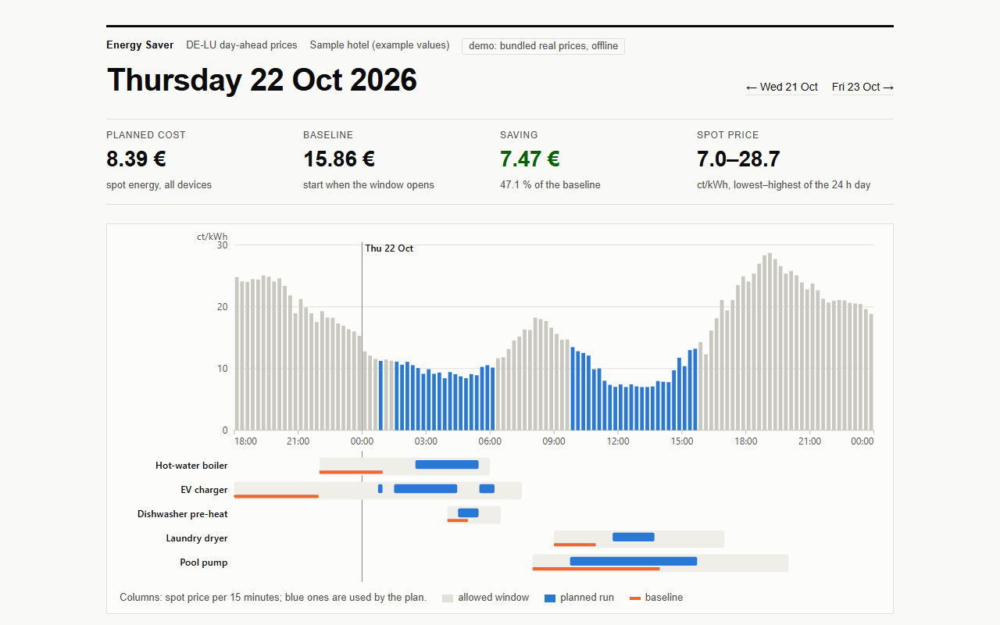
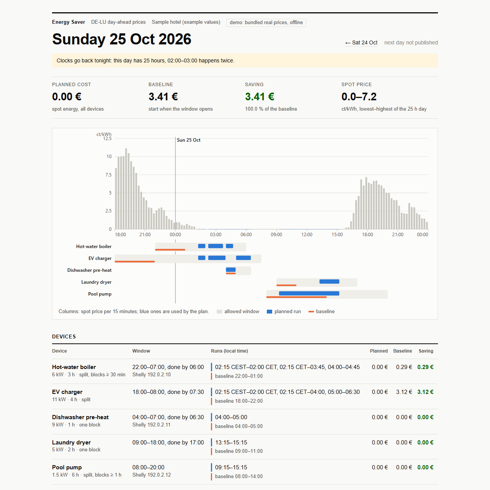
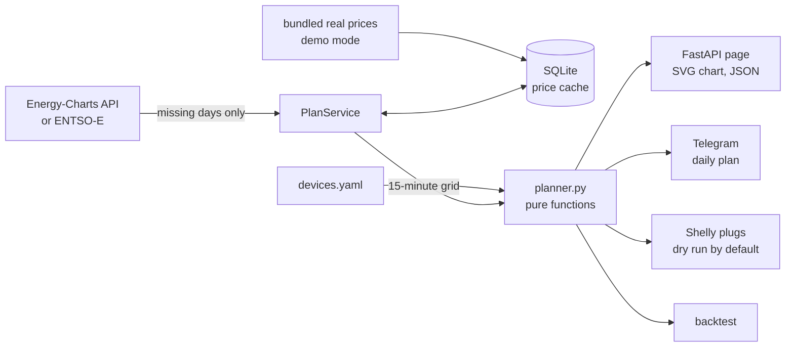

# Energy Saver

Plans when a hotel or café runs its flexible electrical loads (water boiler, EV charger,
laundry dryer, dishwasher pre-heat, pool pump) using the real day-ahead electricity prices
of its bidding zone. Every afternoon it sends tomorrow's plan to Telegram with the expected
saving, shows it on a web page, and can switch Shelly smart plugs (dry run by default).

## Problem

Under Article 11 of Directive (EU) 2019/944, EU countries must let any customer with a
smart meter ask for a *dynamic electricity price contract*, from at least one supplier and
from every supplier with more than 200 000 customers. On such a contract the energy part of
the bill follows the day-ahead market, where the price of the same kWh can differ several
times over within one day. Since 1 October 2025 that market has prices for every
15 minutes.

A boiler with a big tank, a dryer, an EV that is parked overnight: these loads do not care
*when* they run, as long as it happens inside a window. Moving them to the cheap hours saves
money with no new equipment, but nobody at a hotel reception will read a price curve every
afternoon. This program does it and writes the result in plain words.

## Features

- **Real prices:** day-ahead prices from the [Energy-Charts API](https://api.energy-charts.info)
  by Fraunhofer ISE (no token). Optional: the ENTSO-E Transparency Platform with a token.
  Hourly and 15-minute prices are both handled, also mixed in one answer.
- **SQLite cache:** every price is stored once; the API (2 requests per minute) is only
  asked for what is missing, and a 429 answer is respected.
- **`devices.yaml`:** power, run time per day, allowed window (e.g. `22:00-07:00`), latest
  finish, one block or split with a minimum block length, optional Shelly plug, and a power
  cap for all these loads together.
- **Planner:** the cheapest slots that satisfy every rule, compared with a naive schedule
  (each device starts when its window opens). Money is `Decimal`, never float.
- **Time zones and DST:** prices are UTC; plans are in local time. 23- and 25-hour days are
  handled, and the repeated hour is labelled (`02:15 CEST–02:00 CET`).
- **Web page:** FastAPI, server-rendered, with an inline SVG price chart and the plan per
  device. Also `GET /api/plan` (JSON) and `GET /chart.svg`.
- **Telegram (aiogram 3):** tomorrow's plan every afternoon, `/today` and `/tomorrow` on
  demand. Without a token the message is printed in the console.
- **Shelly plugs:** Gen1 and Gen2+ local HTTP API. Dry run by default: the exact request is
  logged instead of sent. Every ON carries a flip-back timer, so a plug turns itself off on
  time even if this program dies.
- **Demo mode:** offline, with 36 days of real DE-LU prices bundled in the repository.
- **Backtest:** `python -m app backtest --days 30` replays real past days.

## Screenshots



The 25-hour day when the clocks went back (25 October 2026, real prices):



| Daily plan in Telegram |
|---|
| [screenshot placeholder] |

## How it works



### Planning rules

1. **Prices on one grid.** Every price is expanded to 15-minute slots: an hourly price becomes
   four equal slots. The planner never has to know where a price came from, and a device can
   start at :15 even with hourly data.
2. **Windows in local time.** A window that crosses midnight belongs to the day it ends on:
   in the plan for Sunday, `22:00-07:00` means Saturday 22:00 to Sunday 07:00. That way
   tonight's run is planned together with tomorrow's prices: the auction closes at 12:00 CET
   and its results come out shortly before 13:00, long before the evening. Windows are converted to UTC with `zoneinfo`, so the same window is 8 hours
   long on the spring DST night and 10 hours long in autumn.
3. **One device:**
   - one block (`contiguous: true`): sliding window with prefix sums, O(n);
   - split, any length: the k cheapest slots;
   - split with `min_block`: a small dynamic program over (slot, slots taken, length of the
     current block). A test checks it against brute force on 300 random cases.
4. **Several devices and a power cap.** Devices are planned one after another, least
   flexible first (smallest window slack, then largest load), each in the capacity the
   earlier ones left. This greedy order is not always the global optimum, but it is
   predictable and fast; with a handful of devices the difference is small, and an exact
   answer would need an integer program. The previous day's plan counts too, because two
   days' windows can overlap in the evening.
5. **Baseline.** What happens without the program: each device starts when its window
   opens (or as soon as the cap allows) and runs until done.
6. **Money.** Prices arrive with two decimals in EUR/MWh and are parsed straight into
   `Decimal` (`json.loads(..., parse_float=Decimal)`); power is `Decimal` kW. Costs are exact
   and rounded to cents only for display.

## Backtest on real prices

```bash
uv run python -m app backtest --days 30
```

Real DE-LU 15-minute prices from 26 September to 25 October 2026, with the sample devices
in [devices.yaml](devices.yaml) (90 kWh of flexible load per day, power cap 18 kW):

| Device | kWh/day | Baseline €/day | Planned €/day | Saving €/day | Saving |
|---|---:|---:|---:|---:|---:|
| Hot-water boiler, 6 kW × 3 h | 18 | 2.91 | 2.45 | 0.47 | 16.0 % |
| EV charger, 11 kW × 4 h | 44 | 9.51 | 6.09 | 3.42 | 36.0 % |
| Dishwasher pre-heat, 9 kW × 1 h | 9 | 1.24 | 1.23 | 0.01 | 0.8 % |
| Laundry dryer, 5 kW × 2 h | 10 | 1.58 | 0.87 | 0.72 | 45.2 % |
| Pool pump, 1.5 kW × 6 h | 9 | 1.22 | 0.95 | 0.27 | 22.3 % |
| **All devices** | **90** | **16.47** | **11.59** | **4.88** | **29.6 %** |

Over the 30 days: 347.55 € instead of 494.03 €, a saving of 146.47 €. A test pins these
numbers, so they cannot drift away from the code.

How to read it honestly:

- It is the **spot (energy) part only**. Grid fees, taxes and the supplier margin are the same
  in every hour, so they do not change the saving in euros, but they make the percentage of
  the *total* bill much smaller.
- The saving depends on the baseline. The EV charger saves the most because its naive start
  is 18:00, the evening peak. The dishwasher saves almost nothing: its window is 2.5 hours
  of an already cheap night.
- The devices are examples, not a real hotel. [Result at a real site]

## Quick start (demo, offline)

Requires [uv](https://docs.astral.sh/uv/) (it installs Python 3.12 itself).

```bash
cp .env.example .env
uv sync
uv run python -m app
```

Open <http://127.0.0.1:8109>. Demo mode is on in `.env.example` (or pass `--demo`): the
prices are the bundled real file, the clock is stopped at the moment it was downloaded
(24 October 2026, 17:27 in Berlin), so "tomorrow" is Sunday 25 October, the 25-hour day.
The Telegram message and the dry-run plug commands are printed in the terminal. Use the
arrows to go back through 36 days.

Other commands: `uv run python -m app plan --day 2026-10-22` prints one plan,
`uv run python -m app backtest --days 30` replays history. With Docker:
`cp .env.example .env && docker compose up --build`.

## Use it for real

1. Describe your loads and the power cap in [devices.yaml](devices.yaml).
2. In `.env` set `DEMO_MODE=false`, your `BIDDING_ZONE` and `TIMEZONE`.
3. Telegram: create a bot with [@BotFather](https://t.me/BotFather), add it to a group, send
   `/id` there, and set `BOT_TOKEN` and `PLAN_CHAT_ID`.
4. `uv run python -m app` on any always-on machine in the building (a mini PC or a Raspberry
   Pi is enough). The plan for tomorrow goes out at `SEND_AT` (14:00 by default).
5. Shelly plugs: add `shelly:` to a device and watch the log for a few days. Only then set
   `SHELLY_DRY_RUN=false`. A plug carries about 2.5–3.5 kW; a 6 kW boiler needs a Shelly
   relay driving a contactor, installed by an electrician.

`uv run python -m app fetch --start 2026-09-20 --end 2026-10-25` fills the cache in one
request (add `--save-fixture file.json` to keep the raw answer, which is how the demo file
was made).

## Configuration

See [.env.example](.env.example).

| Variable | Default | Meaning |
|---|---|---|
| `DEMO_MODE` | `true` in the example | Bundled real prices, offline, fixed clock |
| `DEVICES_FILE` | `devices.yaml` | Devices and power cap |
| `BIDDING_ZONE` | `DE-LU` | Zone as Energy-Charts names it |
| `TIMEZONE` | `Europe/Berlin` | Local time for windows, plans and messages |
| `PRICE_SOURCE` | `energy-charts` | Or `entsoe` (needs `ENTSOE_TOKEN`) |
| `ENERGY_CHARTS_URL` | `https://api.energy-charts.info` | API base URL |
| `ENTSOE_TOKEN` | empty | ENTSO-E Transparency Platform API token |
| `BOT_TOKEN` / `PLAN_CHAT_ID` | empty | Telegram bot and chat; empty = console |
| `SEND_AT` / `SEND_RETRY_UNTIL` | `14:00` / `20:00` | When to send tomorrow's plan, and until when to wait for late prices |
| `SHELLY_DRY_RUN` | `true` | `false` really switches plugs |
| `DATABASE_PATH` | `data/energy.db` | SQLite price cache |
| `HOST` / `PORT` | `127.0.0.1` / `8109` | Web page |

## Data and licence

- Energy-Charts' own data is CC BY 4.0 with attribution to Energy-Charts.info. Day-ahead
  prices for **DE-LU, AT, BE, CH, CZ, DK1, DK2, FR, HU, IT-North, NL, NO2, PL, SE4 and SI** are
  published there as **CC BY 4.0 from Bundesnetzagentur | SMARD.de**. Prices for other zones
  are for private and internal use only (see the
  [API description](https://api.energy-charts.info)). The licence text arrives with every
  answer, is stored in the cache and shown under every plan and message.
- The bundled file [fixtures/energy-charts-de-lu.json](fixtures/energy-charts-de-lu.json) is
  the unchanged answer to
  `GET https://api.energy-charts.info/price?bzn=DE-LU&start=2026-09-20&end=2026-10-25`,
  downloaded on 24 October 2026 at 15:27 UTC, with that metadata in the file. The small
  files in `tests/fixtures/` are real answers for DST days and for the switch from hourly to
  15-minute prices, downloaded the same way.
- EU facts above: Article 11 and the definition in Article 2(15) of
  [Directive (EU) 2019/944](https://eur-lex.europa.eu/legal-content/EN/TXT/?uri=CELEX:32019L0944)
  (text as amended by Directive (EU) 2024/1711); the 15-minute day-ahead go-live on trading
  day 30 September 2025 for delivery 1 October 2025 from
  [EPEX SPOT](https://www.epexspot.com/en/news/market-coupling-steering-committee-confirms-go-live-15-minute-mtu-sdac-trading-day-30)
  and [HUPX](https://hupx.hu/2025/10/01/15-minute-mtu-implemented-sdac). The bundled data
  shows the same switch: hourly prices on 30 September 2025, quarter-hours from 1 October.
  Auction times (order book closes 12:00 CET, results from about 12:57) from the
  [EPEX SPOT trading brochure](https://www.epexspot.com/sites/default/files/2024-12/_Trading%20brochure%202024%20December%20%281%29.pdf).

## Design decisions

- **A pure planner.** `planner.py` has no I/O, so the DST, midnight and power-cap cases are
  plain unit tests with real price files.
- **Missing prices are never invented.** A window without complete prices is reported as
  "not planned"; the backtest skips such days and lists them. Only the plug switcher falls
  back to the baseline schedule (window start, under the cap), so the water still gets hot
  when prices are late.
- **Inline SVG, not matplotlib.** No heavy dependency, crisp at any size, it follows light and
  dark mode, and every column has a tooltip. The x axis is real time, so a 25-hour day is
  wider and shows its repeated hour.
- **Rate limits are part of the design.** The Energy-Charts `/price` endpoint allows two
  requests per minute. The service asks for whole days in one request, remembers failures
  for 10 minutes (tomorrow's prices before the auction) and backs off on 429.
- **Secrets stay out of logs.** The ENTSO-E token travels in the query string, so the httpx
  request log is switched off.

## Project structure

```
app/
  prices.py         15-minute grid, resolution detection, local days
  energy_charts.py  Energy-Charts client and parser (Decimal, 429, licence)
  entsoe.py         optional ENTSO-E client and XML parser
  devices.py        devices.yaml: durations, windows, latest finish, Shelly
  planner.py        slot choice, power cap, baseline, costs (pure)
  service.py        cache first, API for what is missing, plans
  db.py             SQLite: prices, licence, sent plans
  backtest.py       replay past days
  chart.py          inline SVG chart
  messages.py       Telegram text, money and time formatting
  scheduler.py      daily message, plug switching
  shelly.py         Shelly Gen1/Gen2 commands, dry run
  bot.py            /today, /tomorrow
  web.py            FastAPI routes; templates/ has the page
  main.py           command line: serve, plan, backtest, fetch
devices.yaml        sample devices (edit for your site)
fixtures/           bundled real prices for the demo and the backtest
tests/              pytest suite, tests/fixtures/ has real DST-day prices
```

## Tests and linting

```bash
uv run pytest
uv run ruff check . && uv run ruff format --check .
```

100 tests: DST days (23 and 25 hours, hourly and 15-minute, real data), the switch from hourly
to 15-minute prices, windows across midnight, one block vs split, the min-block dynamic
program against brute force, the power cap, baseline costs, API parsing and rate limits with
`httpx.MockTransport`, ENTSO-E XML, the Telegram message, the daily send and retry, Shelly
URLs and dry run, the web page, and the backtest numbers above.

## Limitations

- Spot price only; no grid fees, taxes, or network tariffs that change by time of day
  (some countries have them, and they would change the result).
- Devices have a fixed power. A real boiler stops when its thermostat is satisfied, and an
  EV charges slower when the battery is nearly full.
- Planning is greedy across devices (see above), not a global optimum.
- The ENTSO-E client is tested only against documents built in the documented format from
  real prices; I have no token to test it live.
- The Docker files are written but not tested: Docker is not installed on the machine I
  built this on.
- Not tested with real Shelly hardware; the request formats follow the Shelly API docs.

## Bugs found while building

See [BUGFIX.md](BUGFIX.md).
