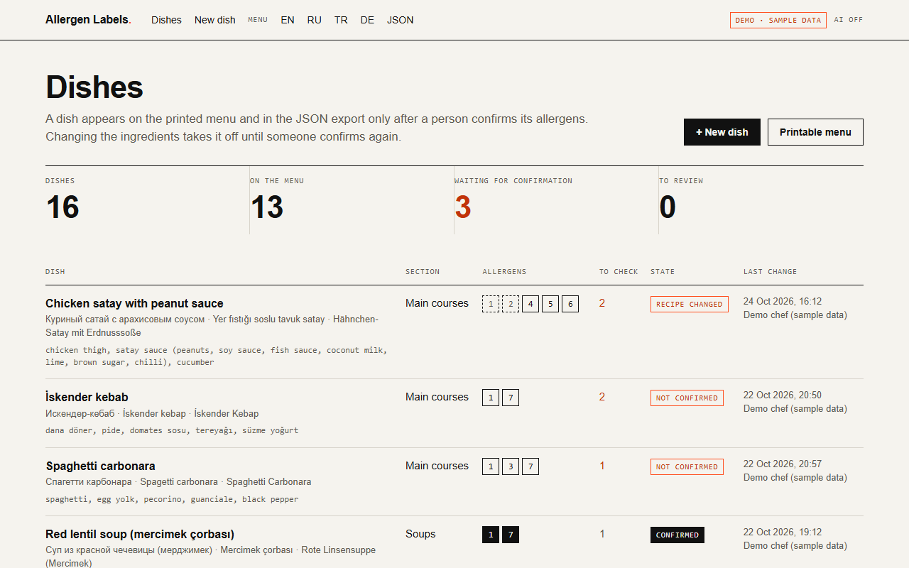
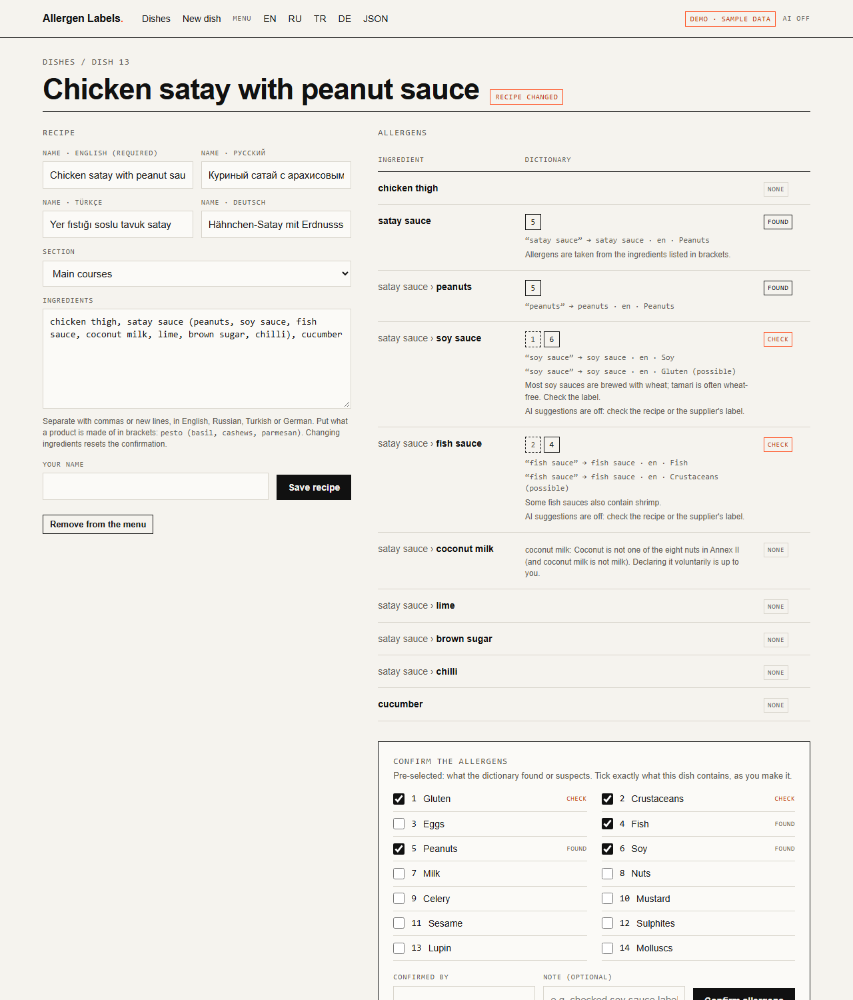
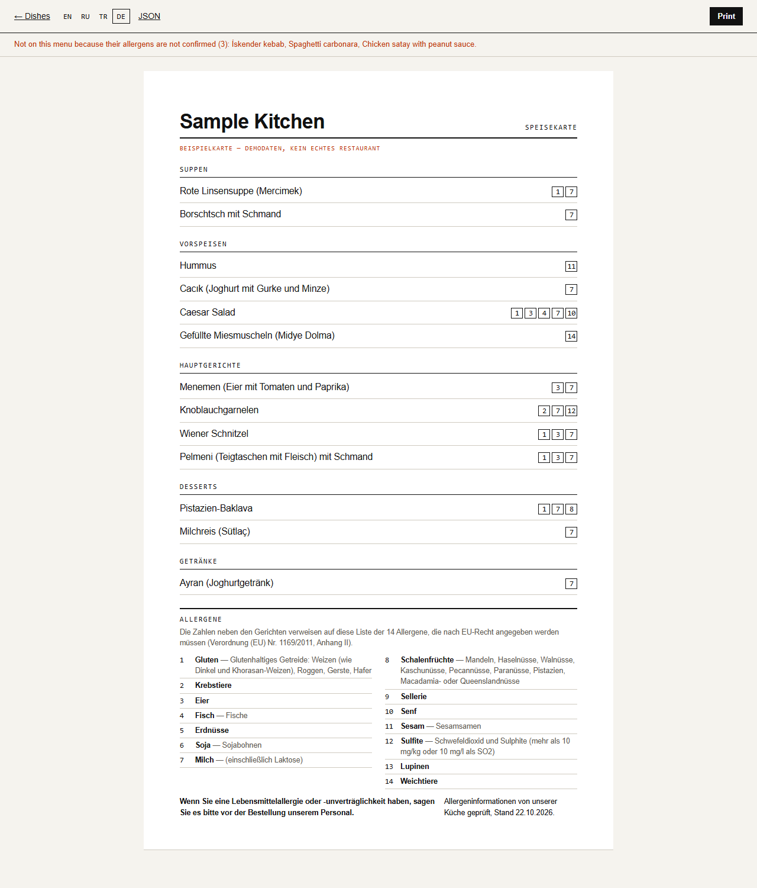
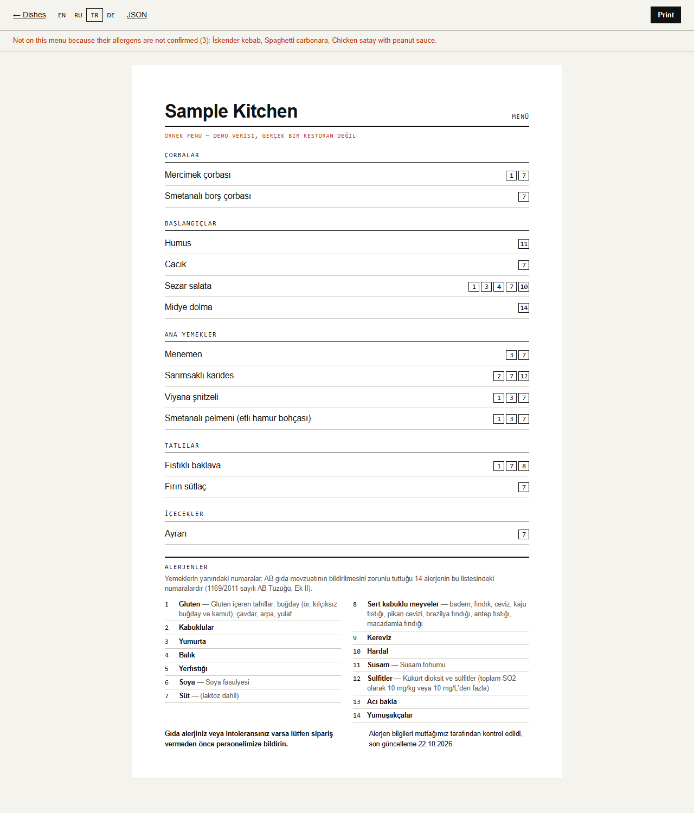
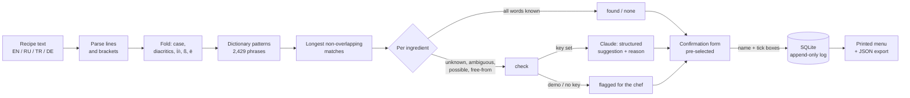
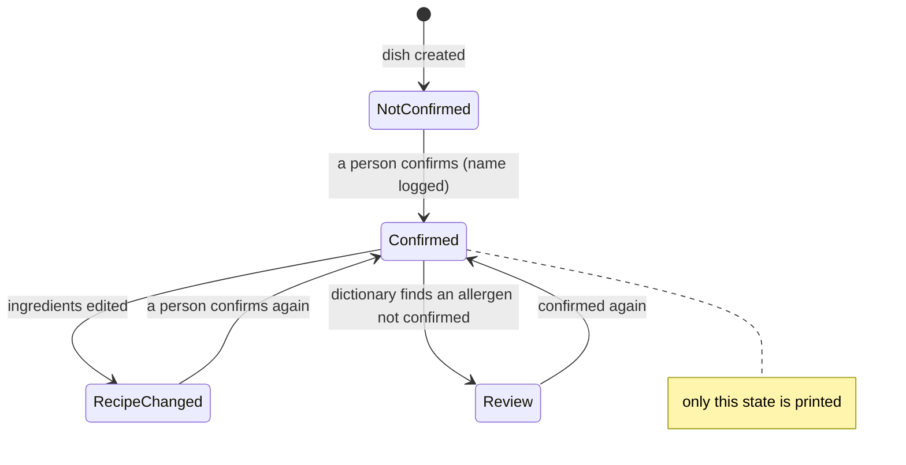

# Allergen Labels

Marks the 14 allergens that EU food law requires to be declared on every dish of a
restaurant or hotel kitchen, and prints the menu with allergen numbers in English,
Russian, Turkish and German. It reads the ingredient lists with a curated multilingual
dictionary, asks an LLM about what it cannot settle, and **publishes nothing until a
person confirms each dish**.

> **This tool assists the kitchen. It does not replace the business's own allergen
> management**, supplier specifications or staff training, and it is not legal advice.
> How allergen information must be shown is decided by each country (see below).

## Problem

Kitchens change recipes often: a new supplier's stock cube, pesto made with cashews instead
of pine nuts, a sauce finished with butter this season. The allergen information on the
menu is written once and goes stale. In Antalya, Spain or Germany the same menu is read by
tourists in several languages, and a guest with a nut allergy has to trust a number next to
a dish name.

What the law asks for (checked against the consolidated text of Regulation (EU) No
1169/2011 of 1 January 2018, as published on EUR-Lex by the EU Publications Office):

- **Art. 9(1)(c)**: any ingredient or processing aid listed in **Annex II**, or derived from
  one, that is used in a food and still present in the finished product must be indicated.
- **Art. 44(1)(a)**: for food offered **without prepackaging** (which includes restaurants
  and other "mass caterers", Art. 2(2)(d)), this allergen information is mandatory.
  **Art. 44(2)**: each Member State may decide *how* it is made available. That is why this
  tool does not decide the presentation for you.
- **Annex II** lists 14 groups, some with exclusions: e.g. wheat-based glucose syrups,
  fully refined soybean oil, lactitol, fish gelatine or isinglass used to fine beer and
  wine, and cereals, whey and nuts used for distilled spirits. Delegated Regulation (EU) No
  78/2014 changed point 1 to "wheat (such as spelt and khorasan wheat)".
- **Turkey**: the Turkish Food Codex labelling regulation (Resmî Gazete 26.01.2017, No
  29960 Mükerrer) lists the same 14 groups in its Ek-1; the Turkish names in the app are
  taken from it.

Sources: [Regulation 1169/2011 on EUR-Lex](https://eur-lex.europa.eu/legal-content/EN/TXT/?uri=CELEX:32011R1169),
[consolidated text 2018-01-01](https://eur-lex.europa.eu/legal-content/EN/TXT/?uri=CELEX:02011R1169-20180101),
[Delegated Regulation 78/2014](https://eur-lex.europa.eu/legal-content/EN/TXT/?uri=CELEX:32014R0078),
[Turkish regulation annexes (Resmî Gazete)](https://www.resmigazete.gov.tr/eskiler/2017/01/20170126M1-6-1.pdf).

## Features

- **The 14 Annex II groups** with their numbers, the official English and German wording,
  the Turkish Food Codex wording, a Russian translation, and the Annex II exclusions.
- **Multilingual dictionary** (EN / RU / TR / DE, 2,429 phrases): ingredient words of each
  group, **composite products** ("pesto" → milk and nuts *possible*, "soy sauce" → soy, and
  gluten *possible*, "Worcestershire sauce" → fish *possible*, "tahini" → sesame), Annex II
  **look-alikes** that are not allergens (coconut, pine nuts, nutmeg, buckwheat, glucose
  syrup, cocoa butter, eggplant…), and common ingredients that have none of the 14.
- **Morphology** for all four languages: English plurals, Russian case endings
  ("сметаной", "яиц"), Turkish suffixes and consonant softening ("fındığı", "peynirli",
  "SÜT", "İRMİK"), German compounds ("Haselnusskrokant", "Vollmilchschokolade"), with or
  without diacritics ("sut", "Haselnusse").
- **Ambiguous words are not guessed**: "fıstık" (peanut or pistachio), "масло" (butter or
  oil), "shellfish", "barbunya" (red mullet or beans) get their candidate groups
  pre-selected and are marked *check*.
- **"Free-from" words never remove an allergen**: "lactose-free milk" is still milk,
  "gluten-free pasta" still needs a look, "yumurtasız" / "без глютена" are flagged.
- **Brackets describe a product**: `pesto (basil, cashews, parmesan)` takes the allergens
  from the listed parts instead of the guess for "pesto".
- **AI suggestions** (optional, Anthropic API, structured output limited to the 14 group
  ids, with a short reason) for unknown or ambiguous ingredients, marked *AI suggestion,
  needs confirmation*. Cached per ingredient and dish.
- **Safety rules**: a dish is published only with a person's confirmation for its
  *current* recipe; every confirmation is logged with who and when in an append-only SQLite
  table; changing the ingredients resets it; a confirmation made on a page opened before
  someone else changed the recipe is refused.
- **Web UI** (FastAPI, plain HTML forms): dish list, recipe editor, analysis with the
  matched word shown for every hit, confirmation form, confirmation log.
- **Printable menu** in EN / RU / TR / DE (A4 print CSS) with allergen numbers per dish and
  the legend; **JSON export** for a website or POS system.
- **CLI**: `uv run python -m app check "spaghetti, egg yolk, pecorino, guanciale"`.
- **Demo mode** offline: 16 sample dishes (menemen, mercimek çorbası, baklava, borscht,
  Wiener Schnitzel…), names in four languages, no keys needed.

## Screenshots

Real screenshots of the demo (`uv run python -m app --demo`), taken with headless Edge.



| A dish whose recipe changed | The printed menu in German | The same menu in Turkish |
|---|---|---|
|  |  |  |

## How it works



A dish's life:



Reordering ingredients, changing letter case or spacing, or renaming the dish does not reset
the confirmation (the recipe hash is order- and case-independent). Changing back to an old
recipe does **not** bring the old confirmation back.

## Quick start (demo, offline)

Requires [uv](https://docs.astral.sh/uv/) (it installs Python 3.12 itself).

```bash
cp .env.example .env
uv sync
uv run python -m app --demo
```

Open <http://127.0.0.1:8110>. Three sample dishes wait for confirmation: an İskender kebab
and a carbonara with ingredients the dictionary does not know (`döner`, `guanciale`), and
a satay whose recipe was changed after it was confirmed. With Docker:
`cp .env.example .env && docker compose up --build`.

For the AI suggestions, set `ANTHROPIC_API_KEY` in `.env`. For real dishes, set
`DEMO_MODE=false` (the sample menu lives in its own `data/demo.db`).

## Command line

```console
$ uv run python -m app check "spaghetti, egg yolk, pecorino, guanciale"
Ingredients: spaghetti, egg yolk, pecorino, guanciale

  spaghetti   found  1
                     1 Gluten <- 'spaghetti'
  egg yolk    found  3
                     3 Eggs <- 'egg yolk'
  pecorino    found  7
                     7 Milk <- 'pecorino'
  guanciale   CHECK  -
                     not in the dictionary: guanciale

Allergens: 1 Gluten · 3 Eggs · 7 Milk
A person must check 1: guanciale
'?' = possible, not certain. This tool assists; a person confirms the dish.
```

Options: `--lang ru|tr|de` for allergen names, `--json`, `--ai` (asks the AI about the
items to check), `-` reads the list from stdin.

## Configuration

See [.env.example](.env.example).

| Variable | Default | Meaning |
|---|---|---|
| `DEMO_MODE` | `true` in the example | Sample menu of 16 dishes in `data/demo.db` |
| `ANTHROPIC_API_KEY` | empty | Enables AI suggestions; empty = flag for the chef |
| `ANTHROPIC_MODEL` | `claude-opus-5-5` | Model for the suggestions |
| `ANTHROPIC_EFFORT` | `medium` | `low` … `max` |
| `AI_SUGGESTIONS` | `true` | `false` = never call the AI |
| `RESTAURANT_NAME` | empty | Title of the printed menu |
| `DATABASE_PATH` | empty | `data/allergens.db` (`data/demo.db` in demo mode) |
| `TIMEZONE` | `Europe/Istanbul` | For confirmation times |
| `HOST` / `PORT` | `0.0.0.0` / `8110` | Web server |

## Endpoints

| | |
|---|---|
| `GET /` | Dish list |
| `GET /dishes/{id}`, `POST /dishes/{id}` | Recipe editor and analysis |
| `POST /dishes/{id}/confirm` | Confirm (needs a name and the recipe hash the page was opened with) |
| `GET /menu?lang=en\|ru\|tr\|de` | Printable menu |
| `GET /api/menu.json?lang=` | Published dishes, legend, unpublished list |
| `GET /api/dishes` | Every dish with its state and analysis |
| `POST /api/check` | `{"ingredients": "..."}` → analysis, nothing saved |

## Measured on a labelled sample

`uv run python -m app.evaluate` runs the dictionary over
[tests/fixtures/labelled_sample.csv](tests/fixtures/labelled_sample.csv): 116 ingredient lines as a
kitchen writes them (28 to 30 per language), which I labelled myself with the Annex II groups
they contain. It is my own sample, not an official data set.

| | Result |
|---|---|
| Expected allergens pre-selected for the chef | 104 of 104 |
| Silent misses (allergen not pre-selected and line not flagged) | 0 |
| Extra allergens pre-selected (the chef unticks them) | 5 (praline and krokant: egg, milk; mayonnaise: mustard) |
| Lines flagged for a person to check | 40 of 116 (first run: 42, see BUGFIX.md, bug 1) |
| Lines with no allergen expected and none pre-selected | 17 of 17 |

Most flags come from words the dictionary does not know ("tinned", "king", "высшего
сорта", "köy", "Bio"). That is the intended trade-off: an unknown word is shown to a
person rather than assumed harmless.

## Tests and linting

```bash
uv run pytest
uv run ruff check . && uv run ruff format --check .
```

207 tests: each of the 14 groups with a word in each of the four languages, Russian,
Turkish and German morphology, false friends ("сырой" is not cheese, "Schweinefleisch" is
not wine, "biraz" is not beer), every Annex II exclusion, free-from words, composite and
bracketed products, ambiguous words, lines where nothing is recognised ("XO", garbled
text), the confirmation rules (logging, reset on recipe change, no restore on revert, stale
page, append-only log, drift), the Anthropic client
against a fake HTTP server, the menu in every language, the JSON export, the CLI and the
labelled sample.

## Project structure

```
app/
  allergens.py   the 14 Annex II groups: numbers, names in 4 languages, exclusions
  dictionary.py  curated EN/RU/TR/DE words, products, look-alikes, safe words
  matcher.py     morphology-aware patterns, longest-match selection, statuses
  text.py        folding (İ/ı, ß, ё, diacritics), recipe parsing, recipe hash
  service.py     dishes, confirmation rules, AI suggestion caching
  db.py          SQLite: dishes, append-only confirmations and events, AI cache
  menu.py        published menu and JSON export
  web.py         FastAPI routes; templates/ has the HTML
  llm/           Anthropic client (structured output) and the offline stand-in
  demo.py        16 sample dishes
  cli.py         `check` command and server start
  evaluate.py    accuracy on the labelled sample
tests/           pytest suite and the labelled sample
```

## Limitations

- **It is a word list, not a food database.** It does not know brand recipes, house-made
  sauces or what a supplier changed. Products with variable recipes are marked *possible*;
  check labels and specifications.
- **Morphology is rule-based**: stems and suffix lists, not a full analyser. Rare word forms
  and typos end up as "unknown" (flagged, not missed). A German compound that contains a
  known allergen word counts as recognised, so its other parts are not checked separately.
- **Sulphites depend on concentration** (more than 10 mg/kg or 10 mg/l as SO2); the tool
  cannot measure that and marks typical sources as *possible*.
- **Cross-contamination** ("may contain") is outside Annex II and outside this tool.
- **No login**: names are typed, not authenticated. Run it on the kitchen's own network or
  behind the business's existing login; the log shows what was entered, not who really
  clicked.
- **Presentation rules differ by country** (Art. 44(2)): some authorities want allergen
  names in words rather than numbers, or a written list available on request. The JSON
  export and the printed legend are a starting point, not a compliance guarantee.
- The Docker files follow the other projects in this repository but were not run here
  (no Docker on the build machine).

## Bugs found while building

See [BUGFIX.md](BUGFIX.md).
